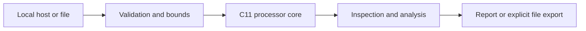

# Pytyliki

Pytyliki is a local C11 workstation for processor inspection, bounded workload analysis, profile review and numerical utilities for systems developers and QA engineers.

[English](README.md) · [Українська](README.uk.md) · [Русский](README.ru.md) · [简体中文](README.zh-CN.md)

<picture>
  <source media="(prefers-color-scheme: dark)" srcset="assets/readme/dashboard.svg">
  
</picture>

[](https://github.com/Ivan-VHS/Pytyliki/actions/workflows/ci.yml) [](https://github.com/Ivan-VHS/Pytyliki/commits/main) [](LICENSE)

[Quick Start](#quick-start) · [Screenshots](#screenshots) · [Architecture](#architecture) · [Roadmap](#roadmap) · [Documentation](docs/README.md) · [Commits](https://github.com/Ivan-VHS/Pytyliki/commits/main)

> **Status:** Active development. The C11 core, CLI utilities, tests and Windows desktop target are present. The GUI is Windows-only; platform probes depend on host capabilities.
>
> **Platforms:** Windows and Linux build/test paths are represented in CI. macOS is not currently claimed as a verified target.

## Quick Start

**Requirements:** CMake 3.16+, a C11 compiler (MSVC, GCC or Clang) and Git. The Win32 GUI is built on Windows; the portable core and CLI are the entry points for other supported build environments.

```sh
cmake -S . -B build -DCMAKE_BUILD_TYPE=Release -DBUILD_TESTING=ON
cmake --build build --config Release --parallel
ctest --test-dir build -C Release --output-on-failure
```

Run a bounded partition example:

```sh
./build/pytyliki --partition 10000 8 256
./build/pytyliki --profile
./build/pytyliki-metrics --demo
```

On Windows, Release executables are normally under `build\\Release\\`. See `pytyliki --help` for the supported CLI options.

## What it does

| Area | Available behavior | Boundary |
|---|---|---|
| Processor inventory | Read local CPU model, topology, memory and available ISA/XCR0 information | Read-only host discovery |
| CPU and memory suite | Run bounded local measurements and workload-partition examples | Host-specific results; not universal benchmarks |
| Benchmark statistics | Summarize supplied samples with percentiles, variability and MAD | Does not launch or repeat workloads |
| Profile import | Read collapsed stacks and Speedscope samples; export folded stacks and SVG flamegraphs | Does not launch a profiler |
| Linux sensors | Read exposed frequency, governor, thermal and energy counters | Read-only sysfs/procfs; unavailable sensors remain unknown |
| Source review and QCS | Parse source and report syntax diagnostics | Does not build or execute reviewed source |
| Embedded C | Browse MCU profiles and estimate FLASH/SRAM usage | Reference estimates; no firmware deployment |
| C ABI and Atomic-Quantum | Build the versioned C ABI v1 library and run a bounded classical state-vector subset | No arbitrary library loading or quantum-hardware access |

Pytyliki produces inspectable measurements and advisory plans. It does not change OS scheduling, CPU affinity, processor frequency or voltage; flash firmware; or claim measured speedups from a proposed partition.

## Why Pytyliki

- One bounded native C11 core supports processor utilities and local CLI workflows.
- Host observations, caller-supplied timing samples and demonstration data remain distinct.
- Reports preserve provenance and unknown values instead of inventing sensor readings.
- Source review and embedded calculations stay advisory and do not execute or deploy code.
- The Windows GUI and portable CLI share the same project boundaries and tests.

## Screenshots

<picture>
  <source media="(prefers-color-scheme: dark)" srcset="assets/readme/workflow-dark.svg">
  
</picture>

<p align="center">
  <a href="assets/screenshots/pytyliki-workstation.png"></a>
</p>
<sub>Real 1920×1080 Windows application capture produced by the desktop-build workflow. The SVG above is an architecture diagram, not a screenshot.</sub>

## Architecture



| Path | Responsibility |
|---|---|
| `src/` | C11 core, Win32 GUI, CLI entry points, processor probes, QCS and interop |
| `tests/` | Native unit, regression, boundary and CLI smoke tests |
| `tools/` and `scripts/` | Profile/sensor helpers and engineering checks |
| `docs/` | Feature, architecture, safety and UI contracts |
| `assets/screenshots/` | Captured desktop evidence |
| `.github/workflows/` | CI, Windows packaging and release automation |

## Compatibility

| Target | Toolchain | Current scope |
|---|---|---|
| Windows | CMake 3.16+, MSVC or another supported C11 compiler | Core, CLI and Win32 GUI build |
| Linux | CMake 3.16+, GCC or Clang | Core/CLI and Linux host probes |
| macOS | Not verified in the current CI matrix | Not advertised as supported |

Optional sanitizers are enabled with `-DPYTYLIKI_ENABLE_SANITIZERS=ON` on GCC or Clang; this option is not supported with MSVC.

## Revival highlights

- The first screen now leads with the product, status, platforms and a working build command.
- The real Windows capture remains separate from editable SVG architecture artwork.
- Light and dark SVG assets use equal canvas dimensions and repository-local paths.
- Capability limits, host-data provenance and the absence of a hosted web service are explicit.

| Previous README flow | Updated README flow |
|---|---|
| Long overview before first run | Build and test commands near the top |
| One fixed-theme diagram | Light/dark SVG pair with equal dimensions |
| Repeated capability narrative | Compact capability and boundary table |
| Broad platform assumptions | Explicit targets, evidence and limits |

## Roadmap

- [x] C11 core, CLI utilities and native test targets.
- [x] Windows desktop target and CI packaging path.
- [x] Read-only discovery and bounded-analysis boundaries documented.
- [ ] Extend platform probes only alongside platform-specific fixtures and CI evidence; this is a proposed direction, not a shipped capability.

## Ecosystem

| Project | Role |
|---|---|
| [DuckOS](https://github.com/Ivan-VHS/DuckOS) | Operating-system project and Mora desktop workspace |
| [Reaper](https://github.com/Ivan-VHS/Reaper) | Systems language and developer workbench |
| [OPlague](https://github.com/Ivan-VHS/OPlague) | Read-only device and driver evidence workbench |
| [VentuSample](https://github.com/Ivan-VHS/VentuSample) | Procedural sample generation and offline DSP |

See the [documentation index](docs/README.md), [architecture contract](docs/ARCHITECTURE.md) and [contribution guide](CONTRIBUTING.md). License: [MIT](LICENSE).
