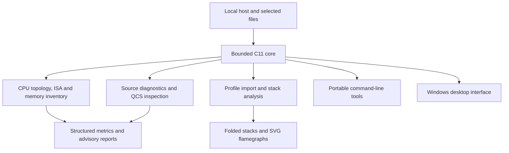

# Pytyliki — Processor Systems Workstation

**A local processor-systems workstation built around a bounded C11 core, a Windows desktop interface and portable command-line tools.**

<p align="center">
  
</p>

<p align="center">
  <a href="assets/screenshots/pytyliki-workstation.png">
    
  </a>
</p>

<p align="center">
  [](https://github.com/Ivan-VHS/Pytyliki/actions/workflows/ci.yml)
  [](https://github.com/Ivan-VHS/Pytyliki/actions/workflows/desktop-build.yml)
  [](LICENSE)
</p>

[English](README.md) · [Українська](README.uk.md) · [Русский](README.ru.md) · [简体中文](README.zh-CN.md)

**Scope:** processor and file inspection, bounded local analysis and advisory reports. Hardware discovery is read-only; Pytyliki does not change OS scheduling, affinity, voltage, frequency or firmware.

## Data and analysis flow



## Capabilities

| Work area | What it provides |
|---|---|
| Processor inventory | CPU topology, ISA and memory inventory |
| Bounded measurements | Local CPU/memory measurements and workload-partition examples |
| Profiling | Profile import, stack analysis, folded stacks and SVG flamegraphs |
| Source inspection | Source diagnostics and QCS syntax inspection |
| Embedded reference | MCU FLASH/SRAM reference estimates |
| Reports and ABI | Versioned C ABI, structured reports, provenance and explicit limitations |

Read more in [Features](docs/FEATURES.md), [Architecture](docs/ARCHITECTURE.md), [Benchmark statistics](docs/BENCHMARK_STATISTICS.md), [Embedded C](docs/EMBEDDED_C.md) and [QCS](docs/QCS_NATIVE.md).

## Build and test

Requirements: CMake 3.16+, a C11 compiler (MSVC, GCC or Clang) and Git. The Win32 GUI is Windows-only; the core and CLI are portable. Python is optional for extra repository-contract checks, not for the C11 runtime.

```sh
cmake -S . -B build -DCMAKE_BUILD_TYPE=Release -DBUILD_TESTING=ON
cmake --build build --config Release --parallel
ctest --test-dir build -C Release --output-on-failure
```

## First CLI checks

```sh
./build/pytyliki --profile
./build/pytyliki --suite
./build/pytyliki --partition 10000 8 256
./build/pytyliki-metrics --demo
```

## Safety and integration boundaries

- Hardware discovery is read-only.
- Reports are advisory and retain provenance and limitations.
- Workload partition examples do not alter the host scheduler or process affinity.
- Embedded FLASH/SRAM values are reference estimates, not a device programming operation.
- [Reaper policy integration](docs/REAPER_INTEGRATION.md) is an optional CI validation example, not an application runtime dependency.

Documentation and integration: [Documentation index](docs/README.md) · [Release process](docs/RELEASE.md) · [Report envelope](docs/REPORT_ENVELOPE.md) · [Shared ecosystem standards](https://github.com/Ivan-VHS/DuckOS/blob/main/docs/SHARED_STANDARDS.md).

[Contributing](CONTRIBUTING.md) · [Security policy](SECURITY.md) · [MIT License](LICENSE)
