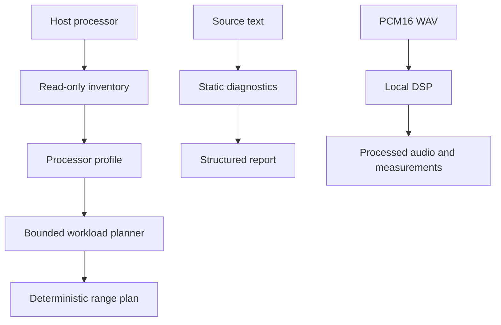
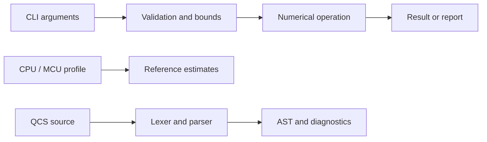

# Pytyliki — Processor Systems Workstation

[English](README.md) · [Українська](README.uk.md) · [Русский](README.ru.md) · [简体中文](README.zh-CN.md)

> Documentation synchronized with the implementation on 2026-11-21; the Windows screenshot is generated by the desktop-build workflow.
[CI](https://github.com/Ivan-VHS/Pytyliki/actions/workflows/ci.yml) · [Windows desktop build](https://github.com/Ivan-VHS/Pytyliki/actions/workflows/desktop-build.yml) · C11 · Windows/Linux · MIT
**Developer:** [Ivan-VHS](https://github.com/Ivan-VHS)

Pytyliki is a modular native workstation for processor discovery, bounded workload planning, source diagnostics, numerical tools and local DSP. The Windows desktop workstation and portable command-line tools share one C11 core.

The workstation reports observed processor data; its advisory plans do not change operating-system scheduling, CPU affinity, clock or voltage settings.

## Live Windows workstation

<p align="center"></p>

## Functional data flow

The diagram summarizes implemented data movement between the project's input sources, processing stages and generated outputs.



## Runtime and output paths

This second view separates execution paths and supported outputs from catalogue-only or unavailable behavior.



<sub>Actual application capture · 1920×1080 source image · original pixels retained; no artificial upscaling.</sub>

## Capability matrix

| Module | Current scope | Safety boundary |
|---|---|---|
| CPU | identity, topology, memory, ISA/XCR0 and processor profiles | read-only discovery |
| Benchmarks | CPU, memory, matrix and checked workload partitioning | bounded local measurements |
| Source review | static diagnostics and structured reports | does not build or execute inspected source |
| DSP | PCM16 WAV, filtering, compression, saturation and metering | local buffers; validated RIFF chunk bounds |
| Memory | typed views, checked slices, arenas and pools | fixed limits and checked ranges |
| Embedded C | MCU profiles, FLASH/SRAM estimates and MMIO model | simulation/reference data only |
| Rules / APSIA / TRACE | advisory routing, workload plans and measurement provenance | evidence, not certification |
| QCS | lexer, parser, AST and diagnostics | syntax analysis only |
| Atomic quantum | 133 stable IDs and bounded C11 state-vector kernels: normalization, gates, measurement and noise | classical simulation only; no hardware access |
| Interop | versioned C ABI v1 | explicit trusted library selection |

## Build and test

Requirements: CMake 3.16+, a C11 compiler and Git.

```sh
cmake -S . -B build -DCMAKE_BUILD_TYPE=Release -DBUILD_TESTING=ON
cmake --build build --config Release --parallel
ctest --test-dir build -C Release --output-on-failure
```

The Windows desktop workflow builds the GUI and CLI tools, runs CTest, and publishes a Windows x64 archive. The current archive contains `pytyliki-gui.exe`, `pytyliki.exe`, `pytyliki-apsia.exe` and `pytyliki-metrics.exe`.

## Command-line examples

```sh
pytyliki --profile
pytyliki --suite
pytyliki --systems
pytyliki --embedded profiles
pytyliki-metrics --demo

pytyliki --divide -17 5
pytyliki --partition 10000 8 256
pytyliki --partition-auto 10000 256
```

Partition plans are deterministic, bounded and advisory. They describe contiguous work ranges; they do not launch threads, change CPU affinity or claim an unmeasured speedup.

## Catalogues

| Catalogue | Entries |
|---|---:|
| Systems-language capabilities | 66 |
| CPU / MCU / virtual-ISA profiles | 14 |
| Systems-lab functions | 33 |

[Atomic-Quantum 133](docs/ATOMIC_QUANTUM_133.md) · [Features](docs/FEATURES.md) · [UI motion](docs/UI_MOTION.md) · [Architecture](docs/ARCHITECTURE.md) · [Division and partitioning](docs/DIVISION_ENGINE.md) · [TRACE provenance](docs/TRACE_MEASUREMENT_PROVENANCE.md) · [Documentation index](docs/README.md)

[Українська](README.uk.md) · [Русский](README.ru.md) · [简体中文](README.zh-CN.md) · [Releases](https://github.com/Ivan-VHS/Pytyliki/releases) · [MIT](LICENSE)


## Bounded resource-allocation reference
An illustrative 500 UAH budget model with a versioned JSON contract and an offline simulator. This is a documentation example, not a feature of the host runtime.

[Multilingual guide](docs/RESOURCE_ALLOCATION_500_UAH.md) · [Interactive simulator](docs/resource-allocation-500-uah.html) · [JSON example](examples/resource-allocation-500-uah.json) · [JSON Schema](schemas/resource-allocation.v1.schema.json)

## Beelzebul repository protection

This repository uses the versioned [Beelzebul 66-rule security policy](SECURITY.md), machine-readable [policy](security/beelzebul.v1.json), and read-only [scanner](tools/beelzebul.py). Run `python tools/beelzebul.py` locally; GitHub Actions runs the same gate for pull requests and protected-branch updates.
