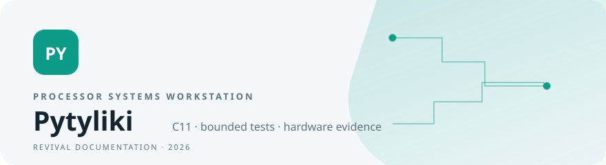

<picture><source media="(prefers-color-scheme: dark)" srcset="assets/readme/hero-banner-dark.svg"><source media="(prefers-color-scheme: light)" srcset="assets/readme/hero-banner-light.svg"></picture>

<h1 align="center">Pytyliki — Processor Systems Workstation</h1>

<strong>A native C11 workstation for read-only processor discovery, bounded local tests, numerical tools and source diagnostics.</strong>

  

[Quick start](#quick-start) · [Revival](#documentation-revival) · [Visuals](#visual-overview) · [Architecture](#architecture) · [Docs](docs/README.md)

> **Boundary:** processor discovery and source review are read-only. Pytyliki does not change CPU affinity, OS scheduling, clock or voltage settings, flash firmware, or deploy embedded code. The Win32 GUI is Windows-only; the C11 core and CLI are portable where platform APIs are available.

## Quick start

**Requirements:** CMake 3.16+, a C11 compiler (MSVC, GCC or Clang) and Git.

~~~sh
git clone https://github.com/Ivan-VHS/Pytyliki.git
cd Pytyliki
cmake -S . -B build -DCMAKE_BUILD_TYPE=Release -DBUILD_TESTING=ON
cmake --build build --config Release --parallel
ctest --test-dir build -C Release --output-on-failure
~~~

First smoke checks:

~~~sh
./build/pytyliki --profile
./build/pytyliki --suite
./build/pytyliki --partition 10000 8 256
./build/pytyliki-metrics --demo
~~~

On Windows, Release binaries are placed under build/Release/. The Win32 GUI target is built on Windows only.

## Documentation revival

| Before | Revival documentation |
|---|---|
| Single static banner | Theme-aware light/dark SVG hero |
| Product overview mixed with implementation detail | Clear purpose, explicit boundaries and runnable quick start |
| Screenshot and flow art not clearly distinguished | Real desktop capture paired with a separately labelled architecture illustration |
| Feature maturity spread across pages | Evidence-led capability summary linked to feature matrix and architecture map |
| Navigation buried in long sections | Dedicated documentation index, visual standard and contributor checklist |

This is a documentation refresh, **not a software version claim or a new release**. Source, schemas, tests and CI remain authoritative for implementation status.

## Implemented scope

| Area | Current capability | Boundary |
|---|---|---|
| Processor inventory | CPU identity, topology, memory and available ISA/XCR0 | Local, read-only discovery |
| Benchmarks | Bounded CPU/memory tests and workload partition examples | Host-dependent measurements |
| Profile tools | Import collapsed stacks and Speedscope; export folded stacks and SVG flamegraphs | Does not launch a profiler |
| Source review | Static diagnostics and structured reports | Does not compile, run or rewrite source |
| Embedded C / QCS | MCU resource estimates and syntax/AST inspection | Reference/simulation and syntax analysis |
| C ABI | Versioned ABI v1 | Explicit loading of a trusted library |
| Atomic-Quantum | Bounded classical state-vector subset | Simulation; no quantum-hardware access |

## Visual overview

<table><tr><td width="50%">
<strong>Real application capture</strong> — Windows desktop, 1920×1080. Not a browser demo.
</td><td width="50%">
<strong>Architecture illustration</strong> — implemented data path, not a UI screenshot.
</td></tr></table>

## Architecture

~~~mermaid
flowchart LR
  A[Local input / processor probe] --> B[Validation and bounds]
  B --> C[Native C11 core]
  C --> D[Structured result]
  D --> E[CLI or Win32 GUI]
  D --> F[Optional report export]
  G[Tests and platform checks] --> C
~~~

## Configuration

There is no application .env, account, API token or hosted-service configuration. Actual CMake options:

| Option | Default | Purpose |
|---|---:|---|
| BUILD_TESTING | CMake default | Configure native tests and optional contract checks |
| PYTYLIKI_ENABLE_SANITIZERS | OFF | Enable ASan/UBSan on supported GCC/Clang builds |

## Repository map

| Path | Responsibility |
|---|---|
| src/ | C11 core, processor probes, CLI, Win32 GUI, QCS and interop |
| tests/ | Unit, regression, boundary and CLI smoke tests |
| tools/ / scripts/ | Validation, profile import and engineering checks |
| docs/ | Architecture, feature contracts, UI and engineering standards |
| assets/readme/ | Theme-aware hero and workflow illustration |
| assets/screenshots/ | Captured desktop images |
| .github/workflows/ | CI, Windows packaging and repository gates |

## Verification and status

~~~sh
ctest --test-dir build -C Release --output-on-failure
python scripts/validate_errors.py
git diff --check
~~~

See [Features](docs/FEATURES.md), [Architecture](docs/ARCHITECTURE.md), the [information architecture map](docs/INFORMATION_ARCHITECTURE.md) and [automation roadmap](docs/AUTOMATION_ROADMAP.md). Catalog counts and reference models are not hardware certification.

## Contributing

Read [CONTRIBUTING.md](CONTRIBUTING.md) before changing the core, ABI or platform probes. Security findings belong in [SECURITY.md](SECURITY.md). Publishing rules are in [README Visual Standard](docs/README_VISUAL_STANDARD.md).

## License

[MIT](LICENSE).
