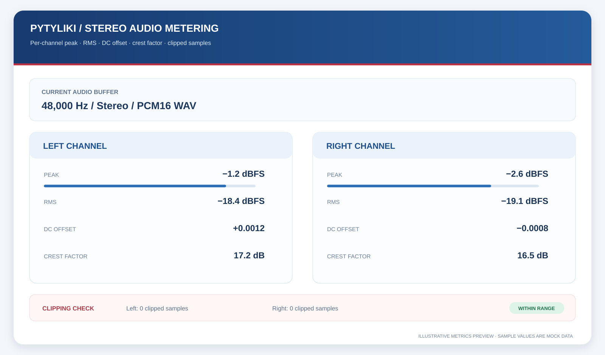

# Pytyliki — Processor Systems Workstation

  
  
  
  

<strong>DISCOVER · ANALYZE · PROCESS · VERIFY</strong>

Pytyliki is a modular C11 workstation for local processor inspection, bounded benchmarks, source diagnostics and PCM16 audio processing. It includes a native Win32 desktop interface, a command-line interface and a testable engineering catalogue.

**Read this in:** [English](README.md) · [Русский](README.ru.md) · [Українська](README.uk.md) · [简体中文](README.zh-CN.md)

## Visual tour

These repository visuals are source-aligned SVG previews and an architecture diagram. They are not photographs or screenshots captured from a running Windows session. A genuine Win32 capture must be taken on a Windows desktop session.

## Workstation capabilities

| Area | Current functionality |
|---|---|
| Processor inventory | CPU identity, architecture, logical processors, memory and usable ISA capabilities |
| Benchmarks | Bounded processor, memory and matrix workloads for local comparison |
| Source review | Static diagnostics for supported files; no execution or rewriting of scanned source |
| Audio / DSP | PCM16 WAV import/export, tone generation, filtering, compression, saturation and gain |
| Channel metering | Independent peak, RMS, DC offset, crest factor and clipping counts per channel |
| Windows desktop | Native Win32 workstation with a centralized white-red-blue control theme |
| Engineering catalogue | Syntax-pie, CPU Suite Pro, Forge66, TriMatrix, HyperFusion, APSIA and advisory hardware rules |
| Verification | CMake/CTest, Windows and Linux CI, Linux ASan/UBSan, and a read-only HMGA audit |

## Quick start

### Requirements

- Windows or Linux
- CMake 3.16+
- A C11-capable compiler
- Git

### Build and test

    git clone https://github.com/Ivan-VHS/Pytyliki.git
    cd Pytyliki
    cmake -S . -B build -DCMAKE_BUILD_TYPE=Release -DBUILD_TESTING=ON
    cmake --build build --config Release --parallel
    ctest --test-dir build -C Release --output-on-failure

On Windows, the build also produces the native pytyliki-gui.exe target.

### Useful commands

    ./build/pytyliki --profile
    ./build/pytyliki --suite
    ./build/pytyliki --improvement-plan
    ./build/pytyliki --systems
    ./build/pytyliki --tone-out test-tone.wav --frequency 440 --seconds 3
    ./build/pytyliki --json report.json

Use the platform-specific executable path on Windows, for example build/Release/pytyliki.exe.

## Consolidated engineering updates

The integration branch brings together compatible changes from the existing work:

- **Audio measurement:** per-channel peak/RMS/DC/crest/clipping metrics and CLI/Win32 reporting.
- **WAV safety:** RIFF extent, chunk header, payload and padding boundaries are validated before processing.
- **Shared timing:** processor and benchmark paths use one monotonic millisecond clock with a dedicated contract test.
- **HMGA v2:** a read-only repository auditor, tests and a bounded engineering/evolution policy.
- **HMGA v3:** a deterministic 20-axiom / 400-descriptor C11 catalogue with a maximum of 64 planning rounds.
- **Win32 theme:** centralized white, red and blue UI tokens and owner-drawn controls.
- **CPU Suite cleanup:** catalog ID/name lookup control flow is easier to inspect; lookup behavior is unchanged.

Historical branches were reviewed rather than copied wholesale. Features already present on main remain there; overlapping prototypes are not duplicated. See the [integration audit](docs/INTEGRATION_AUDIT_2026-11-19.md) for the source-by-source reconciliation.

## CI, safety and current scope

The GitHub Actions matrix builds and tests on Ubuntu and Windows. Linux sanitizer coverage runs with AddressSanitizer and UndefinedBehaviorSanitizer. The HMGA audit checks repository evidence and policy; it does not rewrite source files.

- Processor discovery is read-only. No firmware, BIOS/UEFI, clock, voltage, power-limit, kernel, driver or device-register writes are performed.
- Source review does not execute or modify inspected files.
- Benchmark results depend on hardware, compiler, operating system and workload; they are not certification or guaranteed speedups.
- HMGA v3 enumerates bounded planning descriptors. It does not generate or execute source code.
- The native desktop UI is Win32 on Windows. macOS support and guaranteed ARM64/x86_64 performance are not claimed.

## Documentation

- [Architecture](docs/ARCHITECTURE.md)
- [Engineering standard](docs/ENGINEERING_STANDARD.md)
- [HMGA v2.0 contract](docs/HMGA_V2.0.md)
- [HMGA v3.0 operator matrix](docs/HMGA_V3.md)
- [Integration audit](docs/INTEGRATION_AUDIT_2026-11-19.md)
- [APSIA 2.0 routing design](docs/APSIA_2.0.md)
- [Hardware rule engine](docs/HARDWARE_RULE_ENGINE.md)
- [Processor taxonomy](docs/PROCESSOR_TAXONOMY.md)
- [Platform validation policy](docs/PLATFORM_VALIDATION_POLICY.md)

- [AETHER-ANAS engineering profile](docs/AETHER_ANAS_INTEGRATION.md)
- [Architecture 66 contract](docs/ARCHITECTURE_66.md)
- [666-rule conformance profile](docs/CONSTITUTION_666_PROFILE.md)
- [100-proverb engineering crosswalk](docs/CHINESE_PROVERBS_100_ENGINEERING_CROSSWALK.md)
- [MCST Elbrus E2K target profile](docs/ELBRUS_E2K.md)

## License

Released under the [MIT License](LICENSE).
