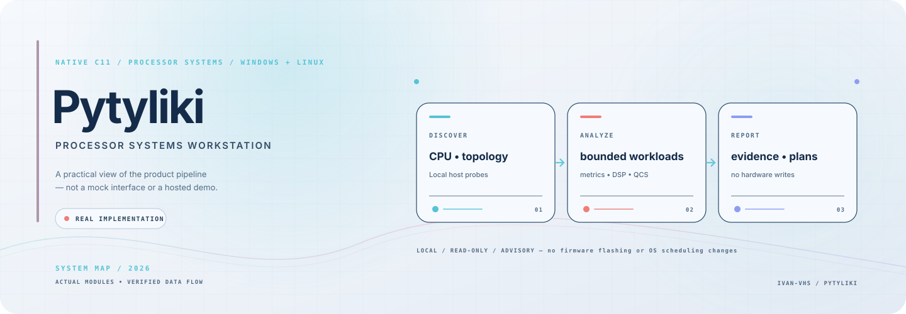
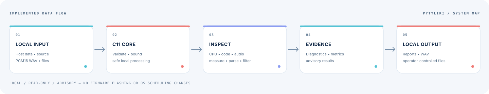
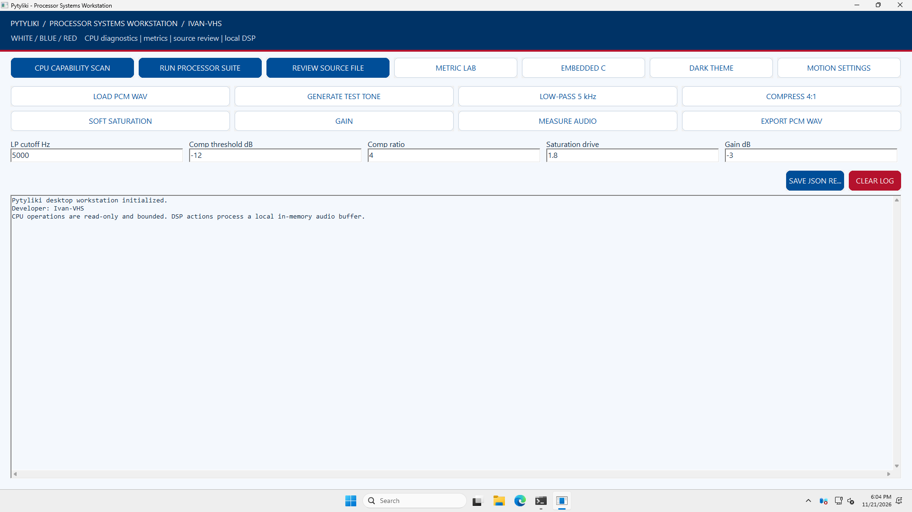
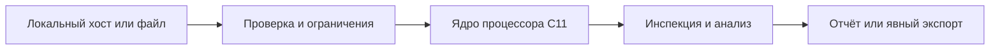

# Pytyliki

Pytyliki — локальная рабочая станция на C11 для анализа процессоров, ограниченного планирования нагрузок, просмотра профилей и числовых инструментов для системных разработчиков и QA-инженеров.

[English](README.md) · [Українська](README.uk.md) · [Русский](README.ru.md) · [简体中文](README.zh-CN.md)

<picture>
  <source media="(prefers-color-scheme: dark)" srcset="assets/readme/dashboard.svg">
  
</picture>

[](https://github.com/Ivan-VHS/Pytyliki/actions/workflows/ci.yml) [](https://github.com/Ivan-VHS/Pytyliki/commits/main) [](LICENSE)

[Быстрый старт](#быстрый-старт) · [Скриншоты](#скриншоты) · [Архитектура](#архитектура) · [План развития](#план-развития) · [Документация](docs/README.md) · [Коммиты](https://github.com/Ivan-VHS/Pytyliki/commits/main)

> **Статус:** активная разработка. В репозитории есть ядро C11, CLI-утилиты, тесты и цель Windows desktop. GUI собирается только для Windows; доступность системных проб зависит от платформы.
>
> **Платформы:** пути сборки и тестирования Windows и Linux представлены в CI. macOS пока не заявляется как проверенная цель.

## Быстрый старт

**Требования:** CMake 3.16+, компилятор C11 (MSVC, GCC или Clang) и Git. Win32 GUI собирается в Windows; переносные ядро и CLI — основные точки входа для других сред сборки.

```sh
cmake -S . -B build -DCMAKE_BUILD_TYPE=Release -DBUILD_TESTING=ON
cmake --build build --config Release --parallel
ctest --test-dir build -C Release --output-on-failure
```

Пример ограниченного распределения задач:

```sh
./build/pytyliki --partition 10000 8 256
./build/pytyliki --profile
./build/pytyliki-metrics --demo
```

В Windows исполняемые файлы Release обычно находятся в `build\\Release\\`. Полный список параметров: `pytyliki --help`.

## Возможности

| Область | Реализованное поведение | Граница |
|---|---|---|
| Инвентаризация процессора | Чтение модели CPU, топологии, памяти и доступных сведений ISA/XCR0 | Только чтение локального хоста |
| CPU и память | Ограниченные локальные измерения и примеры разделения нагрузки | Результаты зависят от машины |
| Статистика бенчмарков | Перцентили, вариативность и MAD для переданных выборок | Не запускает и не повторяет нагрузку |
| Импорт профилей | Collapsed stacks и Speedscope; экспорт folded stacks и SVG flamegraph | Не запускает профайлер |
| Датчики Linux | Доступные счётчики частоты, governor, температуры и энергии | Read-only sysfs/procfs |
| Анализ исходников и QCS | Разбор исходного текста и синтаксическая диагностика | Не собирает и не выполняет проверяемый код |
| Embedded C | Профили MCU и оценка FLASH/SRAM | Справочные оценки, не прошивка |
| C ABI и Atomic-Quantum | Версионированная библиотека C ABI v1 и ограниченная классическая симуляция | Без произвольной загрузки библиотек и доступа к квантовому оборудованию |

Pytyliki предоставляет проверяемые наблюдения и рекомендательные планы. Программа не меняет планировщик ОС, CPU affinity, частоту или напряжение, не прошивает оборудование и не обещает измеренного ускорения от предложенного разделения задач.

## Зачем нужен Pytyliki

- Одно ограниченное нативное ядро C11 обслуживает системные утилиты и локальный CLI.
- Данные хоста, переданные пользователем измерения и демонстрационные примеры разделены.
- Отчёты сохраняют происхождение данных и неизвестные значения, а не выдумывают показания датчиков.
- Проверка исходников и embedded-расчёты носят рекомендательный характер и не выполняют и не развёртывают код.
- Windows GUI и переносной CLI используют общие границы проекта и тесты.

## Скриншоты

<picture>
  <source media="(prefers-color-scheme: dark)" srcset="assets/readme/workflow-dark.svg">
  
</picture>

<p align="center">
  <a href="assets/screenshots/pytyliki-workstation.png"></a>
</p>
<sub>Реальный снимок приложения Windows 1920×1080, созданный workflow сборки desktop-версии. SVG выше — архитектурная схема, а не скриншот.</sub>

## Архитектура



| Путь | Ответственность |
|---|---|
| `src/` | Ядро C11, Win32 GUI, CLI, пробы процессора, QCS и interop |
| `tests/` | Нативные, регрессионные, граничные и CLI smoke-тесты |
| `tools/` и `scripts/` | Утилиты профилей/датчиков и инженерные проверки |
| `docs/` | Контракты функций, архитектуры, безопасности и UI |
| `assets/screenshots/` | Снимки реального desktop-приложения |
| `.github/workflows/` | CI, сборка Windows и автоматизация релизов |

## Совместимость

| Цель | Инструментарий | Текущий объём |
|---|---|---|
| Windows | CMake 3.16+, MSVC или другой совместимый компилятор C11 | Ядро, CLI и Win32 GUI |
| Linux | CMake 3.16+, GCC или Clang | Ядро/CLI и Linux-пробы хоста |
| macOS | Пока не проверяется матрицей CI | Поддержка не заявлена |

Санитайзеры включаются через `-DPYTYLIKI_ENABLE_SANITIZERS=ON` в GCC или Clang; MSVC этот параметр не поддерживает.

## Что нового в README Revival

- На первом экране теперь есть назначение, статус, платформы и рабочая команда сборки.
- Реальный снимок Windows отделён от редактируемой SVG-схемы.
- Светлая и тёмная версии SVG имеют одинаковые размеры и хранятся в репозитории.
- Границы функций, происхождение данных хоста и отсутствие веб-сервиса указаны явно.

| Было | Стало |
|---|---|
| Длинный обзор перед запуском | Команды сборки и тестирования в начале |
| Схема с одной фиксированной темой | Пара SVG для светлой и тёмной тем |
| Повторяющиеся описания возможностей | Компактная таблица функций и ограничений |
| Неочевидные платформенные допущения | Явные цели, подтверждения и ограничения |

## План развития

- [x] Ядро C11, CLI-утилиты и нативные тестовые цели.
- [x] Цель Windows desktop и путь CI-сборки.
- [x] Документированы границы read-only обнаружения и ограниченного анализа.
- [ ] Расширять платформенные пробы только вместе с платформенными тестовыми данными и CI; это предложение, а не реализованная функция.

## Экосистема

- [DuckOS](https://github.com/Ivan-VHS/DuckOS) — операционная система и рабочее пространство Mora.
- [Reaper](https://github.com/Ivan-VHS/Reaper) — системный язык программирования и среда разработчика.
- [OPlague](https://github.com/Ivan-VHS/OPlague) — read-only анализ устройств и свидетельств о драйверах.
- [VentuSample](https://github.com/Ivan-VHS/VentuSample) — процедурная генерация сэмплов и офлайн DSP.

См. [индекс документации](docs/README.md), [архитектуру](docs/ARCHITECTURE.md) и [правила участия](CONTRIBUTING.md). Лицензия: [MIT](LICENSE).
