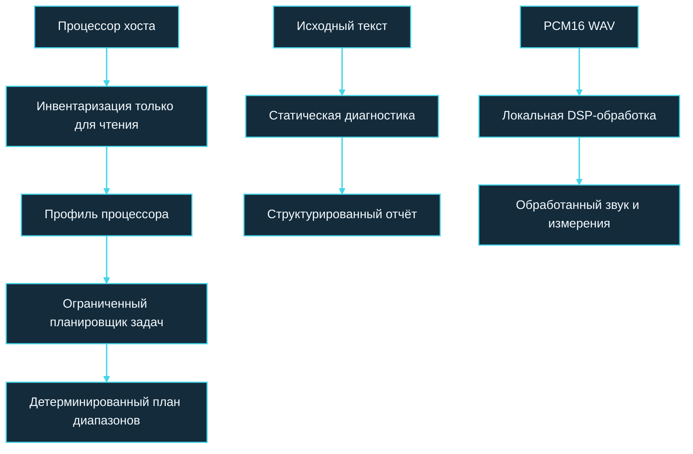
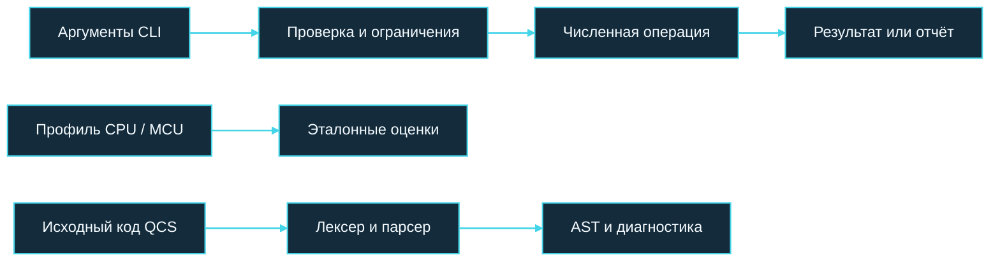

# Pytyliki — рабочая станция процессорных систем

[English](README.md) · [Українська](README.uk.md) · [Русский](README.ru.md) · [简体中文](README.zh-CN.md)

<p align="center"></p>
<sub>Визуальный обзор проекта · README обновлён 22.11.2026 · палитра проекта · читаемые схемы данных</sub>


[CI](https://github.com/Ivan-VHS/Pytyliki/actions/workflows/ci.yml) · [Сборка Windows](https://github.com/Ivan-VHS/Pytyliki/actions/workflows/desktop-build.yml) · C11 · Windows/Linux · MIT
**Разработчик:** [Ivan-VHS](https://github.com/Ivan-VHS)

Pytyliki — модульная нативная рабочая станция для обнаружения характеристик процессора, планирования ограниченных нагрузок, статической диагностики исходников, численных инструментов и локальной DSP. Windows-приложение и CLI используют общее ядро C11.

Рабочая станция показывает полученные сведения о процессоре; рекомендательные планы не меняют планировщик ОС, affinity, частоты или напряжение.

## Реальный снимок Windows-приложения

<p align="center"></p>

## Поток функциональных данных

Схема показывает реализованное движение данных между источниками, этапами обработки и формируемыми результатами проекта.



## Пути выполнения и результатов

Вторая схема отделяет действующие пути выполнения и поддерживаемые результаты от каталожных или недоступных функций.



<sub>Фактический снимок приложения · исходное изображение 1920×1080 · исходные пиксели сохранены, искусственное увеличение не применяется.</sub>

## Возможности

| Модуль | Текущие функции | Граница безопасности |
|---|---|---|
| CPU | модель, топология, память, ISA/XCR0 и профили процессоров | обнаружение только для чтения |
| Тесты | CPU, память, матрицы и проверенное разбиение нагрузки | ограниченные локальные измерения |
| Исходники | статическая диагностика и структурированные отчёты | без сборки и запуска проверяемого кода |
| DSP | PCM16 WAV, фильтрация, компрессия, сатурация и метering | локальные буферы; проверка границ RIFF |
| Память | типизированные views, checked slices, арены и пулы | фиксированные лимиты и проверка диапазонов |
| Embedded C | профили MCU, оценки FLASH/SRAM и модель MMIO | только симуляция и справочные данные |
| Rules / APSIA / TRACE | рекомендации по нагрузкам и происхождение измерений | доказательная база, не сертификация |
| QCS | lexer, parser, AST и диагностика | только синтаксический анализ |
| Interop | версионированный C ABI v1 | явный выбор доверенной библиотеки |

## Сборка и тесты

Требуются CMake 3.16+, компилятор C11 и Git.

```sh
cmake -S . -B build -DCMAKE_BUILD_TYPE=Release -DBUILD_TESTING=ON
cmake --build build --config Release --parallel
ctest --test-dir build -C Release --output-on-failure
```

Windows workflow собирает GUI и CLI, запускает CTest и публикует архив Windows x64. В архив входят `pytyliki-gui.exe`, `pytyliki.exe`, `pytyliki-apsia.exe` и `pytyliki-metrics.exe`.

## Примеры CLI

```sh
pytyliki --profile
pytyliki --suite
pytyliki --systems
pytyliki --embedded profiles
pytyliki-metrics --demo

pytyliki --divide -17 5
pytyliki --partition 10000 8 256
pytyliki --partition-auto 10000 256
```

Планы разбиения детерминированы, ограничены и носят рекомендательный характер. Они описывают непрерывные диапазоны работ, но не создают потоки, не меняют CPU affinity и не обещают неподтверждённое ускорение.

## Каталоги

| Каталог | Записей |
|---|---:|
| Возможности системного языка | 66 |
| Профили CPU / MCU / виртуальных ISA | 14 |
| Функции системной лаборатории | 33 |

[Функции](docs/FEATURES.md) · [UI motion](docs/UI_MOTION.md) · [Архитектура](docs/ARCHITECTURE.md) · [Деление и разбиение](docs/DIVISION_ENGINE.md) · [TRACE](docs/TRACE_MEASUREMENT_PROVENANCE.md) · [Индекс документации](docs/README.md)

[English](README.md) · [Українська](README.uk.md) · [简体中文](README.zh-CN.md) · [Релизы](https://github.com/Ivan-VHS/Pytyliki/releases) · [MIT](LICENSE)


## Справочник распределения бюджета
Пример модели бюджета 500 грн с JSON-контрактом и автономным симулятором. Это документационный пример, а не функция runtime самого приложения.

[Мультиязычный справочник](docs/RESOURCE_ALLOCATION_500_UAH.md) · [Интерактивный симулятор](docs/resource-allocation-500-uah.html) · [Пример JSON](examples/resource-allocation-500-uah.json) · [JSON Schema](schemas/resource-allocation.v1.schema.json)
