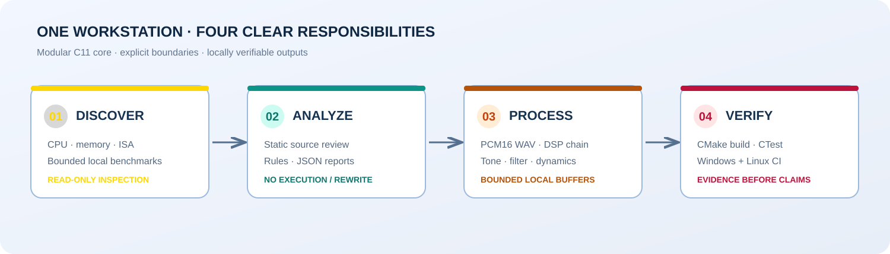

# Pytyliki — робоча станція процесорних систем

  
  
  
  

<strong>ВИЯВЛЕННЯ · АНАЛІЗ · ОБРОБКА · ПЕРЕВІРКА</strong>

Pytyliki — модульна робоча станція на C11 для локальної діагностики процесора, обмежених бенчмарків, статичного аналізу початкового коду та обробки PCM16-аудіо. Проєкт містить нативний настільний інтерфейс Win32, CLI та тестований інженерний каталог.

**Мови:** [English](README.md) · [Русский](README.ru.md) · Українська · [简体中文](README.zh-CN.md)

## Візуальний огляд

У репозиторії є SVG-прев’ю, побудовані за вихідним кодом, та схема архітектури. Це не фотографії й не знімки екрана запущеного застосунку Windows. Для справжнього знімка Win32-інтерфейсу потрібна Windows-сесія робочого столу.

## Можливості робочої станції

| Напрям | Поточні можливості |
|---|---|
| Інвентаризація процесора | Ідентифікація CPU, архітектура, логічні процесори, пам’ять і доступні ISA-можливості |
| Бенчмарки | Обмежені навантаження CPU, пам’яті й матриць для локального порівняння |
| Аналіз коду | Статична діагностика підтримуваних файлів без їх запуску або переписування |
| Аудіо / DSP | Імпорт/експорт PCM16 WAV, генерація тону, фільтрація, компресія, сатурація та gain |
| Вимірювання каналів | Незалежні peak, RMS, DC offset, crest factor і кількість кліппованих відліків для кожного каналу |
| Windows desktop | Нативна Win32-робоча станція з єдиною біло-червоно-синьою темою |
| Інженерний каталог | Syntax-pie, CPU Suite Pro, Forge66, TriMatrix, HyperFusion, APSIA та рекомендаційні апаратні правила |
| Перевірка | CMake/CTest, CI для Windows і Linux, Linux ASan/UBSan та read-only аудит HMGA |

## Швидкий старт

### Вимоги

- Windows або Linux
- CMake 3.16+
- Компілятор із підтримкою C11
- Git

### Збирання й тести

    git clone https://github.com/Ivan-VHS/Pytyliki.git
    cd Pytyliki
    cmake -S . -B build -DCMAKE_BUILD_TYPE=Release -DBUILD_TESTING=ON
    cmake --build build --config Release --parallel
    ctest --test-dir build -C Release --output-on-failure

У Windows-збірці також створюється нативна ціль pytyliki-gui.exe.

### Корисні команди

    ./build/pytyliki --profile
    ./build/pytyliki --suite
    ./build/pytyliki --improvement-plan
    ./build/pytyliki --systems
    ./build/pytyliki --tone-out test-tone.wav --frequency 440 --seconds 3
    ./build/pytyliki --json report.json

У Windows використовуйте шлях до виконуваного файла своєї конфігурації збірки, наприклад build/Release/pytyliki.exe.

## Об’єднані інженерні оновлення

Гілка інтеграції об’єднує сумісні зміни з наявної розробки:

- **Вимірювання аудіо:** незалежні peak/RMS/DC/crest/clipping для кожного каналу та виведення у CLI/Win32.
- **Безпека WAV:** перевірка меж RIFF, заголовків чанків, даних і байтів вирівнювання до обробки.
- **Спільний таймер:** вимірювання процесора й бенчмарки використовують єдине монотонне джерело часу; додано окремий контрактний тест.
- **HMGA v2:** read-only аудит репозиторію, тести й обмежена інженерна політика.
- **HMGA v3:** детермінований каталог із 20 аксіом і 400 дескрипторів C11 з обмеженням у 64 раунди планування.
- **Win32-тема:** централізовані білі, червоні та сині кольорові токени й owner-drawn елементи керування.
- **CPU Suite:** код пошуку модулів за ID та ім’ям став простішим для перевірки; поведінку пошуку не змінено.

Історичні гілки перевірялися, а не копіювалися повністю. Функції, які вже є в main, збережено без дублювання; альтернативні прототипи не створюють паралельних API. Детальна звірка є в [аудиті інтеграції](docs/INTEGRATION_AUDIT_2026-11-19.md).

## CI, безпека та межі проєкту

GitHub Actions збирає й тестує проєкт на Ubuntu та Windows. У Linux тести запускаються з AddressSanitizer і UndefinedBehaviorSanitizer. HMGA-аудит перевіряє інженерні артефакти й правила репозиторію, але не переписує вихідний код.

- Діагностика процесора працює лише на читання. Запис у firmware, BIOS/UEFI, частоти, напругу, ліміти потужності, ядро ОС, драйвери чи регістри пристроїв не виконується.
- Аналіз коду не запускає та не змінює перевірювані файли.
- Результати бенчмарків залежать від обладнання, компілятора, ОС і навантаження; це не сертифікація й не гарантія прискорення.
- HMGA v3 перераховує обмежені планові дескриптори, але не генерує та не виконує вихідний код.
- Настільний інтерфейс реалізовано на Win32 для Windows. Підтримка macOS і гарантована продуктивність ARM64/x86_64 не заявляються.

## Документація

- [Архітектура](docs/ARCHITECTURE.md)
- [Інженерний стандарт](docs/ENGINEERING_STANDARD.md)
- [Контракт HMGA v2.0](docs/HMGA_V2.0.md)
- [Матриця операторів HMGA v3.0](docs/HMGA_V3.md)
- [Аудит інтеграції](docs/INTEGRATION_AUDIT_2026-11-19.md)
- [Маршрутизація APSIA 2.0](docs/APSIA_2.0.md)
- [Рушій апаратних правил](docs/HARDWARE_RULE_ENGINE.md)
- [Таксономія процесорів](docs/PROCESSOR_TAXONOMY.md)
- [Політика перевірки платформ](docs/PLATFORM_VALIDATION_POLICY.md)

## Ліцензія

Проєкт поширюється за [ліцензією MIT](LICENSE).
