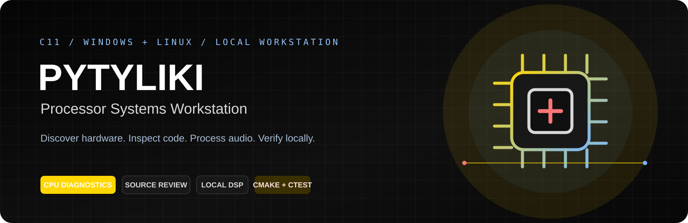

# Pytyliki — робоча станція процесорних систем

<p align="center">
  <a href="https://github.com/Ivan-VHS/Pytyliki/actions/workflows/ci.yml"></a>
  
  
  
</p>

<p align="center"><strong>ВИЯВЛЕННЯ · АНАЛІЗ · ОБРОБКА · ПЕРЕВІРКА</strong></p>

<p align="center"></p>

**Практична робоча станція на C11 для дослідження комп’ютера й локальних навантажень.** Pytyliki поєднує читання характеристик процесора, обмежені бенчмарки, діагностику вихідного коду, інструменти PCM16 WAV/DSP і нативний настільний інтерфейс Windows в одному модульному проєкті.

Проєкт створений для розробників та інженерів, яким потрібні зрозумілі локальні вимірювання, перевірювані звіти й чіткі межі безпеки — без «чорної скриньки», що непомітно змінює апаратні налаштування.

**Мови:** [English](README.md) · [Русский](README.ru.md) · Українська · [简体中文](README.zh-CN.md)

## Робоча станція одним поглядом

| Напрям | Можливості |
|---|---|
| **Процесорна лабораторія** | Дані про CPU, логічні процесори, пам’ять і доступні ISA-можливості |
| **Набір тестів** | Обмежені навантаження для процесора, пам’яті та матриць для локального порівняння |
| **Аналіз коду** | Перевірка підтримуваних файлів без запуску чи переписування; звіти JSON |
| **Аудіо / DSP** | Читання й запис PCM16 WAV, тестові тони, обробка та вимірювання рівнів |
| **Windows desktop** | Нативний Win32 GUI для діагностики CPU, аналізу коду й аудіокерування |
| **Інженерний каталог** | Класифікації покращень, рекомендаційні апаратні правила та довідкові плани |
| **Верифікація** | Збирання CMake і тести CTest у Windows та Linux |

## Інтерфейс

<p align="center"></p>

<sub>Ілюстративне прев’ю, відтворене за елементами й підписами Win32-інтерфейсу в коді. Це не знімок екрана реально запущеної програми Windows.</sub>

Настільна програма надає сканування CPU, процесорні тести, аналіз коду, імпорт/експорт PCM WAV, генерацію тону, low-pass, компресію, сатурацію, підсилення, вимірювання рівнів і експорт JSON-звіту.

## Архітектура

<p align="center"></p>

## Швидкий старт

### Вимоги

- Windows або Linux
- CMake 3.16 або новіший
- Компілятор із підтримкою C11
- Git

### Збирання й тести

```bash
git clone https://github.com/Ivan-VHS/Pytyliki.git
cd Pytyliki
cmake -S . -B build -DCMAKE_BUILD_TYPE=Release -DBUILD_TESTING=ON
cmake --build build --config Release --parallel
ctest --test-dir build -C Release --output-on-failure
```

Збирання для Windows також створює **`pytyliki-gui.exe`**.

### Корисні команди

```bash
# Профіль процесора — лише читання
./build/pytyliki --profile

# Обмежений набір тестів CPU, пам’яті й матриць
./build/pytyliki --suite

# Каталог інженерних покращень
./build/pytyliki --improvement-plan

# Каталог 33 функцій лабораторії блокчейну та процесорних систем
./build/pytyliki --systems-lab

# Створити тестовий PCM16 WAV, 48 кГц
./build/pytyliki --tone-out test-tone.wav --frequency 440 --seconds 3

# Експортувати локальний звіт
./build/pytyliki --json report.json
```

У Windows використовуйте шлях до виконуваного файла відповідної конфігурації, наприклад `build/Release/pytyliki.exe`.

## Інженерні можливості

- **Інвентаризація процесора:** виробник і модель CPU, архітектура, кількість логічних процесорів, пам’ять та ISA-прапорці. Перевірка доступності AVX враховує стан векторів, яким керує ОС.
- **Обмежені вимірювання:** локальні навантаження для процесора, пам’яті та матриць. Результати залежать від платформи й навантаження та не є сертифікацією.
- **Статична діагностика коду:** аналіз підтримуваних файлів без виконання або зміни їхнього вмісту.
- **Аудіоінструменти PCM16:** імпорт/експорт WAV, генерація тону, low-pass, компресор, м’яка сатурація, gain і вимірювання рівнів.
- **Syntax-pie:** детермінований каталог із 20 рівнів, що поєднує функціональні дієслова та синтаксичні абстракції. Це каталог пошуку, а не універсальний парсер.
- **Матриця покращень:** 20 інженерних, 20 оптимізаційних і 20 автоматизаційних класифікацій; показуються через `--improvement-plan`.
- **HyperFusion:** шість обмежених аналітичних модулів і 36 спрямованих парних взаємодій за раунд. Готовність і синергія — евристики планування, а не виміряне прискорення.
- **APSIA 2.0:** планувальник маршрутів між мовними цілями з перевірками доступності та вартості FFI. Він пропонує маршрути, але не компілює й не запускає вибраний мовний модуль.
- **Апаратні правила:** реалізовано 12 рекомендаційних правил; інші ідентифікатори каталогу зарезервовані. Висновки допомагають інженерному аналізу, але не є сертифікацією обладнання.
- **Довідковий конвеєр:** модель планування C11/C23, а не промисловий транспілятор.

- **Лабораторія блокчейну та процесорних систем:** 33 C API для Merkle-доказів, виділення EVM-селекторів, аналізу trace, ізольованої симуляції fork, SPSC-черг, модульної арифметики та планування CPU-оптимізацій. ZK, міжмережевий relay, криптографічна перевірка й FPGA-синтез потребують явних адаптерів; фізичні налаштування CPU та прошивки не змінюються. Див. [контракт лабораторії](docs/BLOCKCHAIN_CPU_SYSTEMS_LAB.md).

## CI, якість і безпека

GitHub Actions збирає та тестує проєкт на **Ubuntu і Windows**. Окреме завдання Linux запускає тести з AddressSanitizer і UndefinedBehaviorSanitizer. Актуальний статус коміту визначають результати CMake/CTest.

Pytyliki дотримується чітких меж локальних операцій:

- Збір даних про процесор доступний лише для читання. Записів у firmware, BIOS/UEFI, microcode, частоти, напругу, ліміти потужності, ядро ОС, драйвери чи регістри пристроїв немає.
- Аналізатор коду не запускає й не переписує файли, які перевіряє.
- Бенчмарки обмежені за обсягом і залежать від обладнання, ОС, компілятора та навантаження; прискорення не обіцяється.
- Рекомендаційні оцінки та плани не є сертифікацією обладнання або доказом автономної оптимізації.
- Локальна обробка аудіо працює з обмеженими PCM16 WAV-буферами.

## Сумісність

| Параметр | Поточний статус |
|---|---|
| Реалізація | ISO C11 |
| Перевірені CI-платформи | Windows і Linux |
| Настільний інтерфейс | Нативний Win32 GUI у Windows |
| Формати даних | JSON-звіти; PCM16 WAV |
| Збирання й тестування | CMake + CTest |
| Не заявляється | Підтримка macOS, гарантована продуктивність ARM64/x86_64, промисловий RTL/FPGA-синтез або автономний трансформер коду |

## Embedded C і профілі мікроконтролерів

Нативне ядро C11 містить каталог профілів Cortex-M4, RV32IMC та ATmega328P,
перевірку бюджету FLASH/SRAM із контролем переповнення, симулятор MMIO-регістрів
із масками дозволених бітів і генератор мінімального шаблону C.

~~~sh
./build/pytyliki --embedded profiles
./build/pytyliki --embedded profile cortex-m4-reference
./build/pytyliki --embedded budget cortex-m4-reference 8192 1024 128 512 2048
./build/pytyliki --embedded template ./main.c
~~~

У Win32-інтерфейсі додано кнопку **EMBEDDED C**. Профілі Cortex-M4 та RV32IMC
є довідковими, а не конфігураціями конкретної плати. Симулятор не звертається до
фізичних MMIO-адрес; генератор не замінює vendor startup, таблицю векторів,
налаштування тактування або перевірку розпіновки. Оркестрація збірки й аналіз
ELF/MAP доступні в Reaper. Див. [посібник Embedded C](docs/EMBEDDED_C.md).

## Документація

- [Архітектура](docs/ARCHITECTURE.md)
- [Маршрутизація APSIA 2.0](docs/APSIA_2.0.md)
- [Механізм апаратних правил](docs/HARDWARE_RULE_ENGINE.md)
- [Таксономія процесорів](docs/PROCESSOR_TAXONOMY.md)
- [Політика перевірки платформ](docs/PLATFORM_VALIDATION_POLICY.md)
- [Модель рекурсивної еволюції](docs/RECURSIVE_EVOLUTION.md)
- [Аудит якості](docs/QUALITY_AUDIT_0.7.1.md)


## Нативний desktop-застосунок

У проєкті вже є нативний **Win32 GUI**. Пакет Windows x64 містить:
- `pytyliki-gui.exe` — настільний інтерфейс для інвентаризації CPU, аналізу коду та інструментів PCM16/DSP.
- `pytyliki.exe` — консольна робоча станція.
- `pytyliki-apsia.exe` — інструмент маршрутизації APSIA.

- [Релізи Windows x64](https://github.com/Ivan-VHS/Pytyliki/releases)
- [Збирання застосунку та CI-артефакти](https://github.com/Ivan-VHS/Pytyliki/actions/workflows/desktop-build.yml)
- [Останні запуски збирання](https://github.com/Ivan-VHS/Pytyliki/actions/workflows/desktop-build.yml?query=branch%3Amain)

Успішна збірка публікує `Pytyliki-windows-x64.zip`; тег `v*` створює GitHub Release. GUI доступний лише у Windows; Linux CI перевіряє переносне ядро C11 та CLI.


## Версіонована пам’ять і нативні C-інтерфейси

Ядро пам’яті використовує **memory ABI v2** (PL_MEMORY_ABI_VERSION = 2): типізовані zero-copy подання, обмежені арени, вирівнювання за фактичною адресою, контрольні точки mark/rewind, необов’язкове очищення звільненого діапазону, телеметрію пікового використання та кількості виділень, користувацькі allocator-callbacks і пули блоків із пам’яттю, що належить викликачеві. Оскільки дескриптор арени містить телеметрію, споживачі, які вбудовують pl_arena_t через бінарну межу, мають перебудуватися з відповідним заголовком та ABI.

Додаткова нативна межа метрик надає **Pytyliki C ABI v1** (PYTYLIKI_ABI_VERSION = 1): визначення версії та функції dot product, норми, відстані й ортогональності для float64. Виклики синхронні, використовують безперервні буфери викликача й не зберігають покажчики після повернення. ABI v1 — вузький інтерфейс сумісності, а не обіцянка доступності кожного модуля Pytyliki з інших мов.

Архітектурний атлас доступний через CLI:

~~~bash
./build/pytyliki --systems
./build/pytyliki --architectures
./build/pytyliki --architecture x86_64
~~~

Докладніше: [Ядро пам’яті ABI v2](docs/MEMORY_ARENA.md), [контракт Architecture 66](docs/ARCHITECTURE_66.md), публічний [заголовок C ABI](src/interop.h).

## Ліцензія

Проєкт поширюється за ліцензією [MIT](LICENSE).

## Додаткове покращення ядра пам’яті

Пул фіксованих блоків тепер переглядає bitmap побайтно: повністю зайняті байти пропускаються, а перший вільний блок у першому неповному байті зберігає детермінований first-fit. Це зменшує зайві перевірки вже заповнених блоків без зміни порядку виділення. Тест перевіряє заповнення 16 блоків, відмову після вичерпання, повторне використання звільненого блока та коректність лічильника зайнятості.


## Екосистема проєктів

Цей репозиторій входить до федерації трьох самостійних проєктів. Reaper відповідає за мову, середовище виконання й оркестрацію; OPlague — за інвентаризацію пристроїв Windows та аналіз пакетів драйверів без змін; Pytyliki — за ядро процесорних, memory- та математичних операцій на C11. See the [Матриця взаємозв’язків 3 × 3](https://github.com/Ivan-VHS/Reaper/blob/main/docs/PROJECT_FEDERATION_MATRIX.md) for the 3 × 3 cross-product, implemented interfaces, data directions and safety boundaries.

- [Reaper — мова й оркестрація] (https://github.com/Ivan-VHS/Reaper/blob/main/README.uk.md) · [integration contract](https://github.com/Ivan-VHS/Reaper/blob/main/docs/FEDERATED_INTEGRATION.md)
- [OPlague — аналіз пристроїв і драйверів] (https://github.com/Ivan-VHS/OPlague/blob/main/README.uk.md) · [integration contract](https://github.com/Ivan-VHS/OPlague/blob/main/docs/FEDERATED_INTEGRATION.md)
- [Pytyliki — процесорне ядро C11] (https://github.com/Ivan-VHS/Pytyliki/blob/main/README.uk.md) · [integration contract](https://github.com/Ivan-VHS/Pytyliki/blob/main/docs/FEDERATED_INTEGRATION.md)
