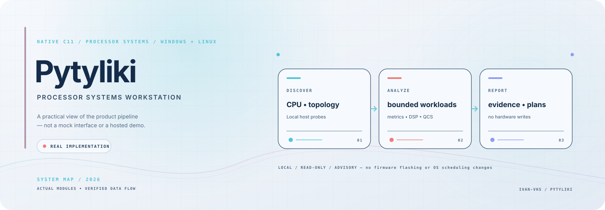
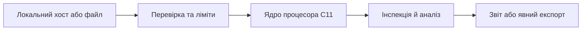

# Pytyliki

Pytyliki — локальна робоча станція на C11 для дослідження процесорів, обмеженого аналізу навантажень, перегляду профілів і числових інструментів для системних розробників та QA-інженерів.

[English](README.md) · [Українська](README.uk.md) · [Русский](README.ru.md) · [简体中文](README.zh-CN.md)

<picture>
  <source media="(prefers-color-scheme: dark)" srcset="assets/readme/dashboard.svg">
  
</picture>

[](https://github.com/Ivan-VHS/Pytyliki/actions/workflows/ci.yml) [](https://github.com/Ivan-VHS/Pytyliki/commits/main) [](LICENSE)

[Швидкий старт](#швидкий-старт) · [Знімки екрана](#знімки-екрана) · [Архітектура](#архітектура) · [План розвитку](#план-розвитку) · [Документація](docs/README.md) · [Коміти](https://github.com/Ivan-VHS/Pytyliki/commits/main)

> **Статус:** активна розробка. У репозиторії є ядро C11, CLI-утиліти, тести та ціль Windows desktop. GUI працює лише у Windows; доступність системних проб залежить від платформи.
>
> **Платформи:** шляхи збирання й тестування Windows та Linux представлені в CI. macOS наразі не заявляється як перевірена ціль.

## Швидкий старт

**Вимоги:** CMake 3.16+, компілятор C11 (MSVC, GCC або Clang) і Git. Win32 GUI збирається у Windows; переносні ядро та CLI — основні точки входу для інших середовищ збирання.

```sh
cmake -S . -B build -DCMAKE_BUILD_TYPE=Release -DBUILD_TESTING=ON
cmake --build build --config Release --parallel
ctest --test-dir build -C Release --output-on-failure
```

Приклад обмеженого розподілу задач:

```sh
./build/pytyliki --partition 10000 8 256
./build/pytyliki --profile
./build/pytyliki-metrics --demo
```

У Windows виконувані файли Release зазвичай містяться в `build\\Release\\`. Повний перелік параметрів показує `pytyliki --help`.

## Можливості

| Напрям | Реалізована поведінка | Межа |
|---|---|---|
| Інвентаризація процесора | Читання моделі CPU, топології, пам’яті та доступної інформації ISA/XCR0 | Лише читання локального хоста |
| CPU та пам’ять | Обмежені локальні вимірювання й приклади поділу навантаження | Результати залежать від обладнання |
| Статистика бенчмарків | Перцентилі, варіативність і MAD для переданих вибірок | Не запускає та не повторює навантаження |
| Імпорт профілів | Collapsed stacks і Speedscope; експорт folded stacks та SVG flamegraph | Не запускає профайлер |
| Датчики Linux | Доступні лічильники частоти, governor, температури та енергії | Лише читання sysfs/procfs |
| Аналіз коду та QCS | Розбір джерела й синтаксична діагностика | Не збирає та не виконує перевірений код |
| Embedded C | Профілі MCU та оцінювання FLASH/SRAM | Довідкові оцінки, не прошивання |
| C ABI та Atomic-Quantum | Версіонована C ABI v1 і обмежена класична симуляція стан-вектора | Без довільного завантаження бібліотек чи квантового обладнання |

Pytyliki надає перевірювані спостереження та рекомендаційні плани. Програма не змінює планувальник ОС, CPU affinity, частоту чи напругу; не прошиває обладнання й не обіцяє виміряного прискорення від запропонованого розподілу.

## Навіщо Pytyliki

- Одне обмежене нативне ядро C11 обслуговує системні утиліти та локальний CLI.
- Дані хоста, передані користувачем вимірювання й демонстраційні приклади чітко розділені.
- Звіти зберігають походження даних і невідомі значення, а не вигадують показники датчиків.
- Перевірка коду та embedded-розрахунки мають рекомендаційний характер і не виконують та не розгортають код.
- Windows GUI та переносний CLI використовують спільні межі проєкту й тести.

## Знімки екрана

<picture>
  <source media="(prefers-color-scheme: dark)" srcset="assets/readme/workflow-dark.svg">
  
</picture>

<p align="center">
  <a href="assets/screenshots/pytyliki-workstation.png"></a>
</p>
<sub>Реальний знімок застосунку Windows 1920×1080, створений workflow збирання desktop-версії. SVG вище — схема архітектури, а не скриншот.</sub>

## Архітектура



| Шлях | Відповідальність |
|---|---|
| `src/` | Ядро C11, Win32 GUI, CLI, проби процесора, QCS та interop |
| `tests/` | Нативні, регресійні, граничні й CLI smoke-тести |
| `tools/` та `scripts/` | Утиліти профілів/датчиків і інженерні перевірки |
| `docs/` | Контракти функцій, архітектури, безпеки та UI |
| `assets/screenshots/` | Знімки справжнього desktop-застосунку |
| `.github/workflows/` | CI, збирання Windows і автоматизація релізів |

## Сумісність

| Ціль | Інструментарій | Поточний обсяг |
|---|---|---|
| Windows | CMake 3.16+, MSVC або інший сумісний компілятор C11 | Ядро, CLI та Win32 GUI |
| Linux | CMake 3.16+, GCC або Clang | Ядро/CLI та Linux-проби хоста |
| macOS | Наразі не перевіряється матрицею CI | Підтримка не заявлена |

Санітизатори вмикаються через `-DPYTYLIKI_ENABLE_SANITIZERS=ON` у GCC або Clang; MSVC цей параметр не підтримує.

## Що змінилося в README Revival

- На першому екрані є призначення, статус, платформи та робоча команда збирання.
- Реальний знімок Windows відокремлено від редагованої SVG-схеми.
- Світлі й темні SVG-версії мають однакові розміри та зберігаються в репозиторії.
- Межі функцій, походження даних хоста й відсутність вебсервісу описані прямо.

| Було | Стало |
|---|---|
| Довгий огляд перед запуском | Команди збирання й тестування на початку |
| Схема з фіксованою темою | Пара SVG для світлої та темної тем |
| Повторювані описи функцій | Компактна таблиця можливостей і меж |
| Неочевидні припущення про платформи | Явні цілі, докази й обмеження |

## План розвитку

- [x] Ядро C11, CLI-утиліти та нативні тестові цілі.
- [x] Ціль Windows desktop і CI-збирання.
- [x] Документовані межі read-only виявлення та обмеженого аналізу.
- [ ] Розширювати платформні проби лише разом із платформними тестовими даними та CI; це пропозиція, а не реалізована функція.

## Екосистема

- [DuckOS](https://github.com/Ivan-VHS/DuckOS) — операційна система та робочий простір Mora.
- [Reaper](https://github.com/Ivan-VHS/Reaper) — системна мова програмування й середовище розробника.
- [OPlague](https://github.com/Ivan-VHS/OPlague) — read-only аналіз пристроїв і доказів щодо драйверів.
- [VentuSample](https://github.com/Ivan-VHS/VentuSample) — процедурна генерація семплів та офлайн DSP.

Дивіться [індекс документації](docs/README.md), [архітектуру](docs/ARCHITECTURE.md) та [правила внеску](CONTRIBUTING.md). Ліцензія: [MIT](LICENSE).
