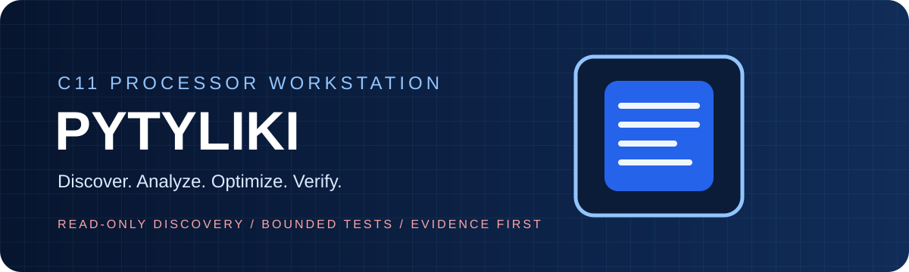
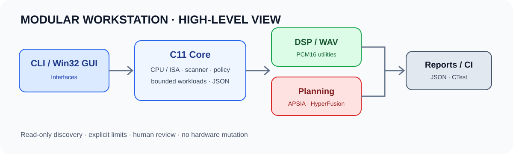
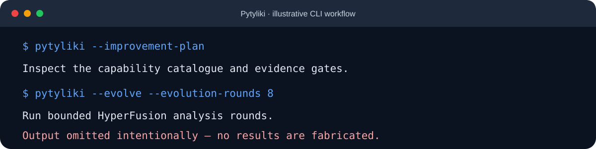

# Pytyliki
### Робоча станція процесорних систем на C11

<p align="center"></p>
<p align="center"><strong>ВИЯВЛЕННЯ · АНАЛІЗ · ОПТИМІЗАЦІЯ · ПЕРЕВІРКА</strong><br>  </p>

**Pytyliki — модульна робоча станція на C11 для читання характеристик процесора, обмежених локальних тестів, аналізу вихідного коду та утиліт PCM16 WAV/DSP.** Містить CLI для Windows/Linux і нативний інтерфейс Win32.

[English](README.md) · [Українська](README.uk.md) · [Русский](README.ru.md) · [简体中文](README.zh-CN.md)

> [!IMPORTANT]
> Pytyliki не перепрограмовує процесори, не записує прошивки, не змінює частоти чи напругу й не гарантує приросту продуктивності.

## Можливості

| Напрям | Реалізація |
|---|---|
| Процесор | Інвентаризація CPU та ISA лише для читання |
| Навантаження | Обмежені тести процесора, пам'яті й матриць |
| Аналіз | Сканер коду без запису та JSON-звіти |
| Аудіо / DSP | PCM16 WAV, генерація тонів, обробка й вимірювання |
| Інтерфейси | CLI для Windows/Linux і нативний GUI Windows |
| Планування | Каталог із 20 можливостей і планування з перевіркою доказів |
| HyperFusion | Шість обмежених аналітичних модулів |
| CI | CMake/CTest на Windows і Linux |

<p align="center"></p>

## Швидкий запуск

Потрібні Git, CMake і компілятор із підтримкою C11 для Windows або Linux.

```bash
git clone https://github.com/Ivan-VHS/Pytyliki.git
cd Pytyliki
cmake -S . -B build -DCMAKE_BUILD_TYPE=Release -DBUILD_TESTING=ON
cmake --build build --config Release --parallel
ctest --test-dir build -C Release --output-on-failure
```

Збірки Windows також містять `pytyliki-gui.exe`.

```bash
pytyliki --improvement-plan
pytyliki --evolve --evolution-rounds 8
pytyliki --syntax-pie
pytyliki --mtte
```

<p align="center"></p>
<sub>Ілюстрація командного сценарію, а не знімок реального запуску чи результат бенчмарку.</sub>

## Архітектура

| Модуль | Призначення |
|---|---|
| `src/core.c/.h` | Профіль CPU, обмежений бенчмарк, сканер, JSON-звіт |
| `src/processor.c/.h` | Інвентаризація процесора/ISA та тести |
| `src/dsp.c/.h` | Обмежені операції WAV і DSP |
| `src/improvement.c/.h` | Каталог покращень і життєвий цикл |
| `src/hw_rules.c/.h` | Рекомендаційні апаратні правила |
| `src/evolution.c/.h` | Аналіз HyperFusion |
| `src/pipeline.c/.h` | Довідковий план конвеєра C11/C23 |
| `src/policy.c/.h` | Локальна політика авторизації |
| `src/cli.c`, `src/win_gui.c` | CLI та GUI Windows |

### Каталог можливостей і стан реалізації

- **Syntax-pie:** детермінований 20-рівневий каталог функцій і синтаксичних абстракцій; не універсальний парсер.
- **MTTE:** 20 семантичних/функціональних/механічних рівнів і логічний лічильник. Він моделює програмне планування, але не змінює апаратні таймери, частоту CPU, регістри, прошивку чи напругу.
- **Матриця покращень:** 20 інженерних, 20 оптимізаційних і 20 автоматизаційних класифікацій.
- **HyperFusion:** шість аналітичних модулів і 36 спрямованих парних взаємодій за раунд. Готовність і синергія — евристики, а не виміряне прискорення.
- **APSIA 2.0:** планувальник маршрутизації мов із перевіркою доступності цілей і вартості FFI; він пропонує маршрути, але не компілює й не запускає модулі.
- **Апаратні правила:** реалізовано 12 рекомендаційних правил; решта ID зарезервовані. Конвеєр C11/C23 — довідковий план, не промисловий транспайлер.

## CI та автоматичне злиття

Для PR до `main` передбачено CMake/CTest на Ubuntu та Windows. Verified Auto-Merge звіряє HEAD PR із перевіреним комітом і вимагає незалежного схвалення, прив'язаного до цього HEAD, перш ніж запитати squash-злиття GitHub.

Потрібно ввімкнути **Allow auto-merge**, захистити `main`, вимагати перевірки й незалежне рев'ю та обмежити права запису завданням злиття. Запит Auto-Merge не означає, що PR уже злито.

## Сумісність і безпека

- Перевірені CI-платформи: Windows і Linux. Реалізація: ISO C11; C23 є лише в довідковому плані.
- Формати: JSON і PCM16 WAV.
- Інвентаризація процесора та сканування коду працюють без запису.
- Навантаження мають обмеження; результати залежать від компілятора, ОС, обладнання та сценарію.
- Немає запису у firmware, BIOS/UEFI, microcode, напругу, частоти, ліміти потужності, ядро ОС, драйвери чи регістри пристроїв.
- Рекомендаційні правила й оцінки не є сертифікацією обладнання або гарантією прискорення.

## Документація

Див. [архітектуру](docs/ARCHITECTURE.md), [APSIA 2.0](docs/APSIA_2.0.md), [політику перевірки платформ](docs/PLATFORM_VALIDATION_POLICY.md) та [аудит якості](docs/QUALITY_AUDIT_0.7.1.md). Статус конкретного коміту визначають результати workflow.

## Ліцензія

MIT — див. [LICENSE](LICENSE).
