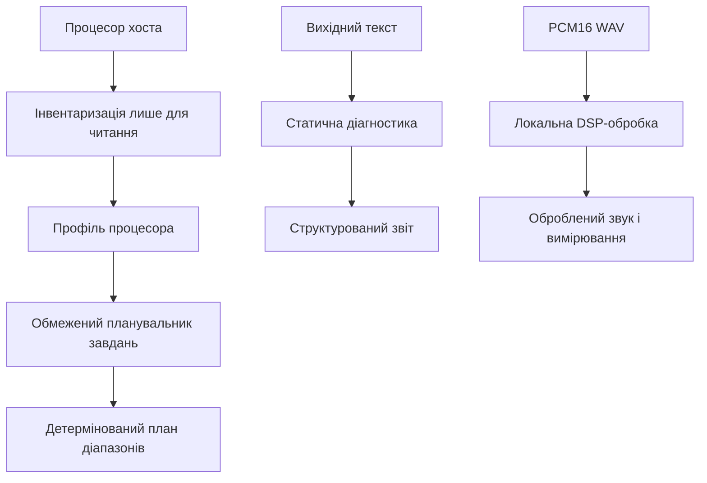
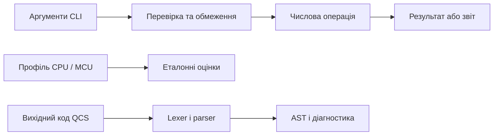

# Pytyliki — робоча станція процесорних систем

[English](README.md) · [Українська](README.uk.md) · [Русский](README.ru.md) · [简体中文](README.zh-CN.md)

[CI](https://github.com/Ivan-VHS/Pytyliki/actions/workflows/ci.yml) · [Збирання Windows](https://github.com/Ivan-VHS/Pytyliki/actions/workflows/desktop-build.yml) · C11 · Windows/Linux · MIT
**Розробник:** [Ivan-VHS](https://github.com/Ivan-VHS)

Pytyliki — модульна нативна робоча станція для виявлення характеристик процесора, планування обмежених навантажень, статичної діагностики коду, числових інструментів і локальної DSP. Застосунок Windows і CLI використовують спільне ядро C11.

Робоча станція показує отримані дані процесора; рекомендаційні плани не змінюють планувальник ОС, affinity, частоти чи напругу.

## Реальний знімок Windows-застосунку

<p align="center"></p>

## Потік функціональних даних

Схема показує реалізований рух даних між джерелами, етапами обробки та сформованими результатами проєкту.



## Шляхи виконання та результатів

Друга схема відокремлює чинні шляхи виконання й підтримувані результати від каталожних або недоступних функцій.



<sub>Фактичний знімок програми · вихідне зображення 1920×1080 · початкові пікселі збережено, штучне збільшення не застосовується.</sub>

## Можливості

| Модуль | Поточні функції | Межа безпеки |
|---|---|---|
| CPU | модель, топологія, пам’ять, ISA/XCR0 і профілі процесорів | виявлення лише для читання |
| Тести | CPU, пам’ять, матриці та перевірене розбиття навантаження | обмежені локальні вимірювання |
| Код | статична діагностика та структуровані звіти | без збирання й виконання перевірюваного коду |
| DSP | PCM16 WAV, фільтрація, компресія, сатурація та вимірювання | локальні буфери; перевірка меж RIFF |
| Пам’ять | типізовані views, checked slices, арени та пули | фіксовані ліміти й перевірка діапазонів |
| Embedded C | профілі MCU, оцінки FLASH/SRAM та модель MMIO | лише симуляція й довідкові дані |
| Rules / APSIA / TRACE | поради щодо навантажень і походження вимірювань | докази, а не сертифікація |
| QCS | lexer, parser, AST і діагностика | лише синтаксичний аналіз |
| Interop | версійований C ABI v1 | явний вибір довіреної бібліотеки |

## Збирання та тести

Потрібні CMake 3.16+, компілятор C11 і Git.

```sh
cmake -S . -B build -DCMAKE_BUILD_TYPE=Release -DBUILD_TESTING=ON
cmake --build build --config Release --parallel
ctest --test-dir build -C Release --output-on-failure
```

Windows workflow збирає GUI та CLI, запускає CTest і публікує архів Windows x64. До архіву входять `pytyliki-gui.exe`, `pytyliki.exe`, `pytyliki-apsia.exe` та `pytyliki-metrics.exe`.

## Приклади CLI

```sh
pytyliki --profile
pytyliki --suite
pytyliki --systems
pytyliki --embedded profiles
pytyliki-metrics --demo

pytyliki --divide -17 5
pytyliki --partition 10000 8 256
pytyliki --partition-auto 10000 256
```

Плани розбиття детерміновані, обмежені й рекомендаційні. Вони описують неперервні діапазони робіт, але не запускають потоки, не змінюють CPU affinity і не обіцяють неперевірене прискорення.

## Каталоги

| Каталог | Записів |
|---|---:|
| Можливості системної мови | 66 |
| Профілі CPU / MCU / віртуальних ISA | 14 |
| Функції системної лабораторії | 33 |

[Можливості](docs/FEATURES.md) · [UI motion](docs/UI_MOTION.md) · [Архітектура](docs/ARCHITECTURE.md) · [Ділення та розбиття](docs/DIVISION_ENGINE.md) · [TRACE](docs/TRACE_MEASUREMENT_PROVENANCE.md) · [Індекс документації](docs/README.md)

[English](README.md) · [Русский](README.ru.md) · [简体中文](README.zh-CN.md) · [Релізи](https://github.com/Ivan-VHS/Pytyliki/releases) · [MIT](LICENSE)


## Довідник розподілу бюджету
Приклад моделі бюджету 500 грн із JSON-контрактом та автономним симулятором. Це документаційний приклад, а не функція runtime самого застосунку.

[Багатомовний довідник](docs/RESOURCE_ALLOCATION_500_UAH.md) · [Інтерактивний симулятор](docs/resource-allocation-500-uah.html) · [Приклад JSON](examples/resource-allocation-500-uah.json) · [JSON Schema](schemas/resource-allocation.v1.schema.json)

## Підтримка Elbrus E2K

Нативне складання C11, ідентифікація процесора, кроскомпіляція та перевірки описані в [посібнику з Elbrus E2K](docs/ELBRUS_E2K.md).
