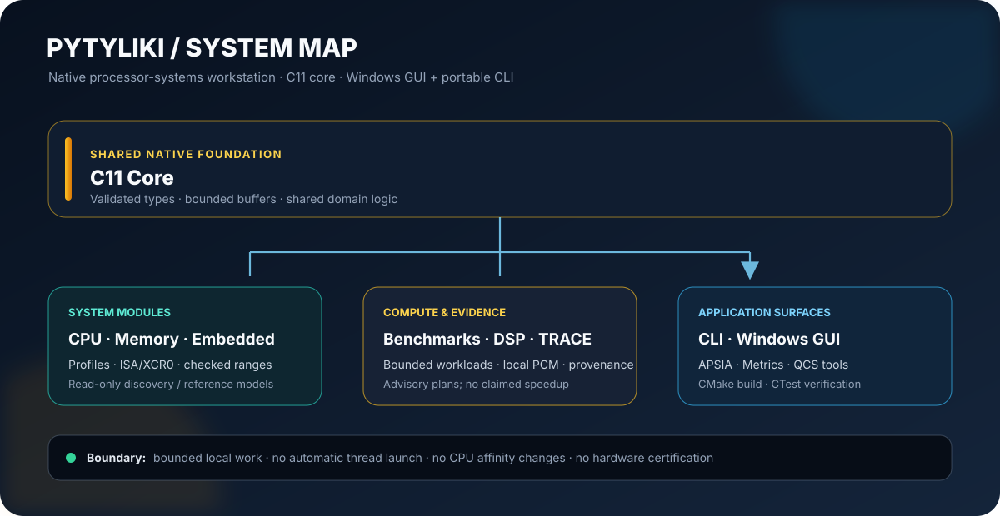

# Pytyliki — 处理器系统工作站

[CI](https://github.com/Ivan-VHS/Pytyliki/actions/workflows/ci.yml) · [Windows 桌面构建](https://github.com/Ivan-VHS/Pytyliki/actions/workflows/desktop-build.yml) · C11 · Windows/Linux · MIT
**开发者：** [Ivan-VHS](https://github.com/Ivan-VHS)

Pytyliki 是一个模块化原生工作站，用于处理器信息发现、有界工作负载规划、源代码静态诊断、数值工具和本地 DSP。Windows GUI 与命令行工具共享同一个 C11 核心。

## Windows 实际运行截图

<p align="center"></p>
<sub>由 desktop-build 工作流捕获的真实桌面画面，1920×1080。</sub>

## 功能范围

| 模块 | 当前功能 | 安全边界 |
|---|---|---|
| CPU | 型号、拓扑、内存、ISA/XCR0 与处理器配置 | 只读检测 |
| 测试 | CPU、内存、矩阵及经过检查的工作负载分区 | 有界本地测量 |
| 源码 | 静态诊断和结构化报告 | 不构建或执行被检查的源码 |
| DSP | PCM16 WAV、滤波、压缩、饱和和电平测量 | 本地缓冲区；验证 RIFF 分块边界 |
| 内存 | 类型化 views、checked slices、arena 和 pool | 固定限制并检查范围 |
| Embedded C | MCU 配置、FLASH/SRAM 估算和 MMIO 模型 | 仅模拟与参考数据 |
| Rules / APSIA / TRACE | 负载建议、任务规划和测量溯源 | 证据记录，不是认证 |
| QCS | lexer、parser、AST 和诊断 | 仅语法分析 |
| Interop | 版本化 C ABI v1 | 显式选择可信库 |

## 界面动效与无障碍

Windows 工作台提供 **Motion Settings**。**Reduce Motion** 会关闭启动窗口过渡；**Eco / Low-CPU Visuals** 会抑制非必要视觉效果。由于 Pytyliki 没有项目传输或主 BPM 来源，**Sync to Transport / BPM** 暂不可用。设置按当前用户保存，并遵循 Windows 客户区动画偏好及 `UI_REDUCED_MOTION` 环境变量。详见 [界面动效规范](docs/UI_MOTION.md)。

## 构建与测试

需要 CMake 3.16+、C11 编译器和 Git。

```sh
cmake -S . -B build -DCMAKE_BUILD_TYPE=Release -DBUILD_TESTING=ON
cmake --build build --config Release --parallel
ctest --test-dir build -C Release --output-on-failure
```

Windows 工作流会构建 GUI 和 CLI 工具、运行 CTest，并发布 Windows x64 压缩包。当前归档包含 `pytyliki-gui.exe`、`pytyliki.exe`、`pytyliki-apsia.exe` 和 `pytyliki-metrics.exe`。

## CLI 示例

```sh
pytyliki --profile
pytyliki --suite
pytyliki --systems
pytyliki --embedded profiles
pytyliki-metrics --demo

pytyliki --divide -17 5
pytyliki --partition 10000 8 256
pytyliki --partition-auto 10000 256
```

分区计划是确定性的、有界的建议。它描述连续工作区间，但不会创建线程、修改 CPU affinity 或声称未经测量的性能提升。

## 目录规模

| 目录 | 条目 |
|---|---:|
| 系统语言能力 | 66 |
| CPU / MCU / 虚拟 ISA 配置 | 14 |
| 系统实验室功能 | 33 |

[功能](docs/FEATURES.md) · [UI motion](docs/UI_MOTION.md) · [架构](docs/ARCHITECTURE.md) · [除法与分区](docs/DIVISION_ENGINE.md) · [TRACE 溯源](docs/TRACE_MEASUREMENT_PROVENANCE.md) · [文档索引](docs/README.md)

[English](README.md) · [Русский](README.ru.md) · [Українська](README.uk.md) · [Releases](https://github.com/Ivan-VHS/Pytyliki/releases) · [MIT](LICENSE)

## DUCK CORE // README 与 Motion Suite

交互式演示和 UI 文档采用统一视觉参考，包含三套配色：**Pond Noir**（默认深色画布）、**Golden Reed**（暖色高对比强调色）和 **Arctic Glacier**（冷色青蓝强调色）。应使用画布、表面、边框、文本、强调色和焦点等语义令牌，避免组件随意硬编码互相冲突的颜色。

动效遵循明确层级：有目的的进入和反馈使用克制的 spring 缓动，常规过渡使用平滑缓动；Zen / Hyper 强度预设仅在应用确实提供时启用。视差、漂浮图形和 ripple 波纹属于非必要装饰，不得承载关键信息或阻挡输入。`reduced-motion` 优先于所有动效模式，并关闭装饰性运动。

**无障碍与响应式：**保持清晰的文本对比度、可见的键盘焦点、适合触控的控件尺寸、明确的 active/disabled 状态，并确保窄屏布局自然折叠。动效不得造成布局跳动或妨碍操作。

本节是 DUCK CORE 视觉参考，**不代表**每个应用都已实现所有主题、动画或控件。实际发布的实现和项目专属规范才是最终依据：[界面动效规范](docs/UI_MOTION.md)。

<!-- VISUAL-DOCS:BEGIN -->
## 架构可视化图



此图为架构示意图，并非应用运行截图。上方真实 Windows 截图仍是已交付界面的视觉依据。SVG、截图、排版、Markdown、图表和渲染规范见[视觉文档](docs/VISUAL_DOCUMENTATION.md)。
<!-- VISUAL-DOCS:END -->
