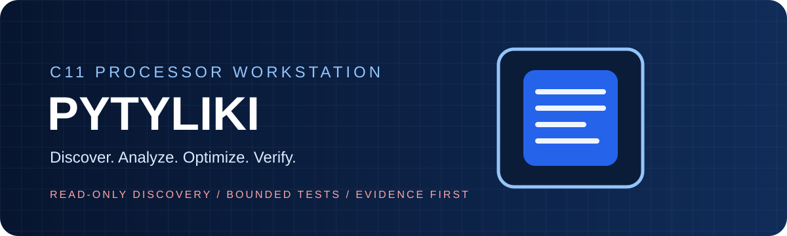
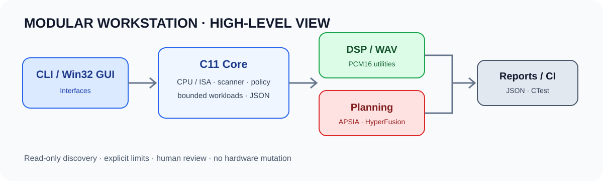
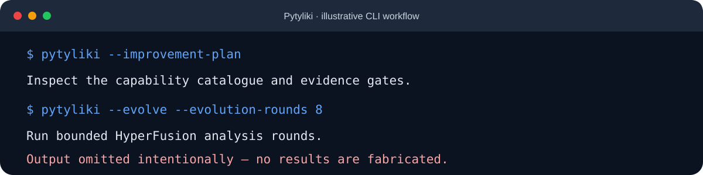

# Pytyliki
### 基于 C11 的处理器系统工作站

<p align="center"></p>
<p align="center"><strong>发现 · 分析 · 优化 · 验证</strong><br>  </p>

**Pytyliki 是一套模块化 C11 工作站，用于只读处理器信息探测、受限本地基准测试、源码诊断，以及 PCM16 WAV/DSP 工具。** 项目提供 Windows/Linux 命令行界面和原生 Win32 图形界面。

[English](README.md) · [Українська](README.uk.md) · [Русский](README.ru.md) · [简体中文](README.zh-CN.md)

> [!IMPORTANT]
> Pytyliki 不会重新编程处理器、写入固件、修改时钟或电压，也不保证性能提升。

## 核心能力

| 领域 | 功能 |
|---|---|
| 处理器 | 只读获取 CPU 与 ISA 信息 |
| 工作负载 | 受限的处理器、内存和矩阵测试 |
| 分析 | 只读源码扫描与 JSON 报告 |
| 音频 / DSP | PCM16 WAV 读写、音调生成、处理与计量 |
| 界面 | Windows/Linux CLI 与原生 Windows GUI |
| 规划 | 20 项能力目录与证据门控规划 |
| HyperFusion | 六个受限分析模块 |
| CI | Windows 和 Linux 上的 CMake/CTest |

<p align="center"></p>

## 快速开始

环境要求：Git、CMake，以及 Windows 或 Linux 上支持 C11 的编译器。

```bash
git clone https://github.com/Ivan-VHS/Pytyliki.git
cd Pytyliki
cmake -S . -B build -DCMAKE_BUILD_TYPE=Release -DBUILD_TESTING=ON
cmake --build build --config Release --parallel
ctest --test-dir build -C Release --output-on-failure
```

Windows 构建还会提供 `pytyliki-gui.exe`。

```bash
pytyliki --improvement-plan
pytyliki --evolve --evolution-rounds 8
pytyliki --syntax-pie
pytyliki --mtte
```

<p align="center"></p>
<sub>命令行展示示意图，并非真实运行截图或基准测试结果。</sub>

## 架构模块

| 模块 | 职责 |
|---|---|
| `src/core.c/.h` | CPU 配置、受限基准测试、扫描器、JSON 报告 |
| `src/processor.c/.h` | 处理器与 ISA 信息及测试 |
| `src/dsp.c/.h` | 受限 WAV 与 DSP 操作 |
| `src/improvement.c/.h` | 改进目录与生命周期 |
| `src/hw_rules.c/.h` | 建议性硬件规则 |
| `src/evolution.c/.h` | HyperFusion 分析 |
| `src/pipeline.c/.h` | C11/C23 参考流水线规划 |
| `src/policy.c/.h` | 本地授权策略 |
| `src/cli.c`、`src/win_gui.c` | CLI 与 Windows GUI |

### 能力目录与实现边界

- **Syntax-pie：** 确定性的 20 层函数/语法抽象目录与查询层，并非通用解析器。
- **MTTE：** 20 个语义/功能/机械层和逻辑 tick 计数器，用于模拟软件调度；不会修改硬件定时器、CPU 频率、寄存器、固件或电压。
- **改进矩阵：** 20 项工程、20 项优化和 20 项自动化分类。
- **HyperFusion：** 六个受限分析模块，每轮 36 个有向配对交互。就绪度和协同值是规划启发式指标，不是实测加速。
- **APSIA 2.0：** 带目标可用性与 FFI 成本门控的 C11 语言路由规划器；只提出路由，不编译或执行所选模块。
- **硬件规则：** 已实现 12 条建议性规则，其余编号为预留项。C11/C23 流水线是参考规划，不是生产级转译器。

## CI 与自动合并

面向 `main` 的 PR 使用 Ubuntu 和 Windows 上的 CMake/CTest 验证。Verified Auto-Merge 工作流会核对当前 PR HEAD 与已验证提交，并要求针对该 HEAD 的独立批准，然后才请求 GitHub Squash Auto-Merge。

仓库需要启用 **Allow auto-merge**、保护 `main`、要求相关检查和独立审查，并限制合并任务的写入权限。发起 Auto-Merge 请求不代表 PR 已合并。

## 兼容性与安全

- 已配置 CI 目标：Windows 和 Linux。实现语言：ISO C11；C23 仅出现在参考流水线规划中。
- 数据格式：JSON 报告与 PCM16 WAV。
- 处理器探测和源码扫描均为只读操作。
- 工作负载具有明确上限；基准结果取决于编译器、操作系统、硬件和工作负载。
- 不写入 firmware、BIOS/UEFI、microcode、电压、时钟、功耗限制、内核、驱动或设备寄存器。
- 建议规则和规划评分不构成硬件认证，也不是性能提升的实测证明。

## 文档

参阅[架构说明](docs/ARCHITECTURE.md)、[APSIA 2.0](docs/APSIA_2.0.md)、[平台验证策略](docs/PLATFORM_VALIDATION_POLICY.md)和[质量审计](docs/QUALITY_AUDIT_0.7.1.md)。具体提交的状态以工作流结果为准。

## 许可证

MIT，详见 [LICENSE](LICENSE)。
