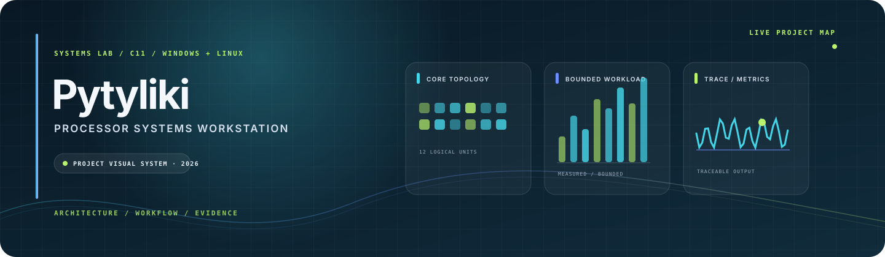

# Pytyliki — 处理器系统工作站

[English](README.md) · [Українська](README.uk.md) · [Русский](README.ru.md) · [简体中文](README.zh-CN.md)

  

> 基于 C11 的本地工作站，用于处理器信息发现、有界测量、源码静态诊断和版本化原生互操作。

**项目记录：** 开发中 · CMake 项目版本 0.8.0 · C11 核心 · Windows 桌面 GUI · Windows/Linux 核心与 CLI · MIT · **文档审核：** 2026-11-27 UTC

## 项目用途与范围

Pytyliki 在本地采集并分析处理器系统信息。C11 核心与命令行工具提供只读主机信息发现、有界 CPU/内存工作负载、源码静态检查和数值指标。Win32 图形界面仅支持 Windows；核心与 CLI 可在 Windows 和 Linux 构建。

硬件发现不会更改 CPU 调度、亲和性、电压、频率、固件、驱动或设备配置。基准测试结果描述的是特定主机上的本地运行，不是通用性能排名。

## 功能

- **处理器盘点：** CPU 拓扑、可用指令集特性和内存信息，并检查操作系统的向量状态。
- **有界测量：** CPU、内存和矩阵工作负载，具有明确的运行限制和结构化结果。
- **源码检查：** 静态诊断与 QCS 语法验证；被检查的源码不会执行或重写。
- **System-array 语法前端：**有界 C11 解析器将已记录的框定别名规范化为 `system(array)`；仅做语法验证，不执行源码，也不访问硬件。
- **数值指标：** 通过稳定的原生 API 提供 C11 向量、距离、几何及二次型运算。
- **内存工具：** 类型化视图、切片溢出检查、有界 arena、回退检查点和固定块池。
- **原生互操作：** 版本化 C ABI v1，使用由调用方拥有的缓冲区；消费者必须显式指定可信库。
- **嵌入式参考工具：** MCU 配置、内存估算、起始代码生成和模拟 MMIO 掩码。这些是参考工具，不提供物理内存映射、真实设备访问或固件烧录。
- **低层硬件契约：** 版本化 target 描述、有界内存区域、具备 capability 检查的 RAM/MMIO 后端、设备 fence、时钟/电源状态请求和固定容量 IRQ 分发表。测试使用 fake backend；尚未提供物理硬件后端。
- **工具链盘点：** 只读发现可用工具；不会安装或启动发现到的程序。

PCM16 WAV/DSP 处理不属于当前 Pytyliki 核心的已交付功能。依赖部分或计划中的能力前，请查阅项目契约和功能文档。

## 构建与验证

需要 CMake 3.16+、C11 编译器（MSVC、GCC 或 Clang）和 Git。Win32 GUI 在 Windows 上构建。Python 仅用于可选的仓库契约辅助检查，并非 C11 核心的运行时。

~~~sh
cmake -S . -B build -DCMAKE_BUILD_TYPE=Release -DBUILD_TESTING=ON
cmake --build build --config Release --parallel
ctest --test-dir build -C Release --output-on-failure
~~~

Linux 下可先运行：

~~~sh
./build/pytyliki --profile
./build/pytyliki --suite
./build/pytyliki --partition 10000 8 256
./build/pytyliki-metrics --demo
~~~

在 Windows 上，请使用所选 CMake 配置目录中的对应可执行文件，例如 `build/Release/pytyliki.exe`。

GCC/Clang 构建可通过 `-DPYTYLIKI_ENABLE_SANITIZERS=ON` 启用 AddressSanitizer 和 UndefinedBehaviorSanitizer。

## 接口与生态

| 接口 | 作用 | 边界 |
|---|---|---|
| `pytyliki.c-abi.v1` | 原生指标 API | 显式库路径；缓冲区归调用方所有 |
| `octa.pyramid.peer-mesh.v1` | 对等节点契约 | 版本化元数据和显式请求 |
| Reaper | 可选指标消费者 | 仅在显式启用并提供可信 ABI 兼容库时使用原生 FFI |
| OPlague | 可选指标消费者 | 显式选择可信库；不允许隐式加载 |

这些集成不会授予硬件权限，也不会扩大工作站只读硬件发现的范围。

## 文档

- [功能概览](docs/FEATURES.md) · [架构](docs/ARCHITECTURE.md)
- [基准统计](docs/BENCHMARK_STATISTICS.md) · [Embedded C 参考工作台](docs/EMBEDDED_C.md)
- [QCS 原生检查](docs/QCS_NATIVE.md) · [100 条底层规则](docs/PYTYLIKI_LOW_LEVEL_100_RULES.md) · [文档索引](docs/README.md)
- [发布流程](docs/RELEASE.md) · [报告封装格式](docs/REPORT_ENVELOPE.md)
- [Reaper 集成](docs/REAPER_INTEGRATION.md) · [生态共享标准](https://github.com/Ivan-VHS/DAK/blob/main/docs/UNIFIED_DOCUMENTATION_STANDARD.md)

## 安全与贡献

将导入的配置和源码视为不可信输入。保持分析过程有界且确定。不要添加隐藏网络活动、特权硬件修改、自动安装工具或写入固件/设备的行为。

修改前请阅读 [CONTRIBUTING.md](CONTRIBUTING.md)。安全问题请按照 [SECURITY.md](SECURITY.md) 报告。本仓库采用 [MIT](LICENSE) 许可证。

---

Pytyliki · README 审核 2026-11-27 UTC

