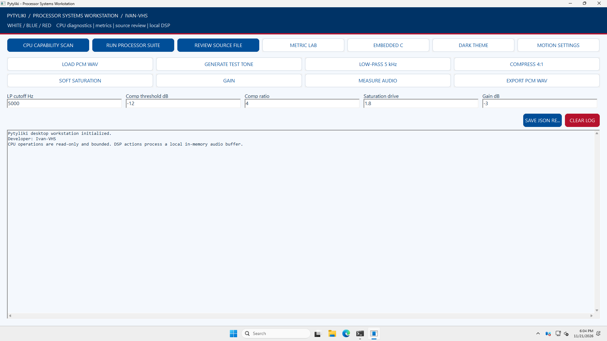

# 🧮 Pytyliki — 处理器系统工作站

[English](README.md) · [Українська](README.uk.md) · [Русский](README.ru.md) · [简体中文](README.zh-CN.md)

  

> **有界处理器分析。原生测量。以证据代替猜测。**

**项目状态:** 开发中 · 有界 C11 核心 · **版本:** 0.8.0 · CMake project · **License:** [MIT](LICENSE) · **README 标准:** Psychoporter 666 v1.0 · **审阅日期:** 2026-11-25 · UTC · **Source:** [Ivan-VHS/Pytyliki](https://github.com/Ivan-VHS/Pytyliki)

## 快速导航

[🚀 Demo: workstation screenshot](assets/screenshots/pytyliki-workstation.png) · [Documentation](docs/README.md) · [Source repository](https://github.com/Ivan-VHS/Pytyliki) · [Issues](https://github.com/Ivan-VHS/Pytyliki/issues)

## 目标与范围

本地处理器系统工作站，采用有界 C11 核心、仅适用于 Windows 的 Win32 桌面界面和可移植命令行工具。硬件发现只读；源码静态审查不会编译、执行或改写被检查文件。

## 功能

- 只读采集 CPU 拓扑、ISA 与内存信息。
- 对 CPU、内存和矩阵执行有界负载及计时统计；结果取决于主机。
- 导入性能分析数据、折叠堆栈和 SVG 火焰图。
- 源码静态诊断、QCS 语法检查，以及 MCU FLASH/SRAM 参考估算。
- 采用调用方拥有缓冲区的版本化 C ABI v1，并生成带数据来源的结构化报告。

## 架构与数据流

~~~mermaid
flowchart LR
  U["User / CLI / Win32 UI"] --> C["C11 core"]
  C --> D["Read-only discovery"]
  C --> B["Bounded measurements"]
  C --> S["Static source and QCS checks"]
  D --> R["Structured evidence report"]
  B --> R
  S --> R
  C --> A["Versioned C ABI v1"]
~~~

源码、架构模式、构建配置、测试和 CI 是已实现行为的依据。路线图与目录仅描述计划或清单，不代表已交付功能。

## 环境要求

需要 CMake 3.16+、C11 编译器（MSVC、GCC 或 Clang）和 Git。核心与 CLI 面向已声明的 Windows/Linux 运行平台；Win32 GUI 仅支持 Windows。Python 是可选测试工具，不是运行时要求。

## 构建

~~~sh
cmake -S . -B build -DCMAKE_BUILD_TYPE=Release -DBUILD_TESTING=ON
cmake --build build --config Release --parallel
ctest --test-dir build -C Release --output-on-failure
~~~

Win32 图形界面仅适用于 Windows。C11 核心和 CLI 是可移植入口。

## 首次检查

~~~sh
./build/pytyliki --profile
./build/pytyliki --suite
./build/pytyliki --partition 10000 8 256
./build/pytyliki-metrics --demo
~~~

这些命令输出依赖本机硬件的结果，不会修改操作系统设置。

## 运行

本地检查请使用可移植 CLI；Win32 图形界面可在 Windows 构建中使用。

## 接口

| 接口 | 契约 / 入口 | 边界 |
|---|---|---|
| CLI | `pytyliki / pytyliki-metrics / pytyliki-qcs` | 本地命令；请通过 `--help` 和功能文档查看用法。 |
| Native FFI | `pytyliki_ffi / C ABI v1` | 必须显式选择库；缓冲区由调用方管理。 |
| 报告 | 版本化 JSON/text | 报告契约包含数据来源与限制。 |

若仓库中没有版本化实现和测试，则不将 REST/GraphQL、WebSocket、OAuth、云部署或 Cookie 机制描述为现有功能。

## 安全与信任边界

不会写入固件、BIOS/UEFI、微码、频率、电压、驱动程序或设备寄存器。Embedded C 的 MMIO 描述仅用于模拟/参考。原生 FFI 必须显式指定可信库路径。

安全策略：[SECURITY.md](SECURITY.md)。请勿在公开问题中发布密钥、设备标识符或私人日志。

## 质量验证

CTest 测试集通过“构建”章节中的命令运行；无需额外的验证命令。

测试范围由已注册的 CTest/unittest 目标和工作流定义。没有公开报告时，不声明覆盖率百分比、模糊测试结果或负载测试报告。

## 性能证据

基准结果取决于主机，仅用于本地比较。仓库记录了统计方法和样本归档；不承诺通用延迟、内存占用或跨机器评分。

## 兼容性

声明的运行平台为 Windows 和 Linux；Win32 GUI 仅支持 Windows。C11 核心和 CLI 是可移植入口。

## 文档与生态

- [Feature matrix](docs/FEATURES.md)
- [Architecture](docs/ARCHITECTURE.md)
- [Benchmark statistics](docs/BENCHMARK_STATISTICS.md)
- [Report envelope](docs/REPORT_ENVELOPE.md)
- [Embedded C](docs/EMBEDDED_C.md)
- [QCS](docs/QCS_NATIVE.md)
- [Documentation index](docs/README.md)
- [Reaper integration](docs/REAPER_INTEGRATION.md)

主要技术参考包括功能矩阵、架构、基准统计和报告封装规范。

跨项目集成使用有文档说明的版本化接口和显式适配器。可选适配器不会授予其他项目运行时权限或硬件访问权限。

## 参与贡献

修改代码或契约前请阅读 [CONTRIBUTING.md](CONTRIBUTING.md)。保持改动可审查，添加确定性测试，并按贡献指南使用 Conventional Commits。

## 许可证与法律说明

本项目依据 [MIT](LICENSE) 许可。软件按许可条款以“按现状”方式提供。第三方项目名称与商标归其各自权利人所有。

本仓库记录的是本地软件接口。除非另行引入并记录托管服务，否则云服务条款、Cookie 同意、OAuth 和 CORS 均不适用于上述本地运行组件。

---

Psychoporter 666 README Standard v1.0 · Ivan-VHS · 2026-11-25 · UTC

