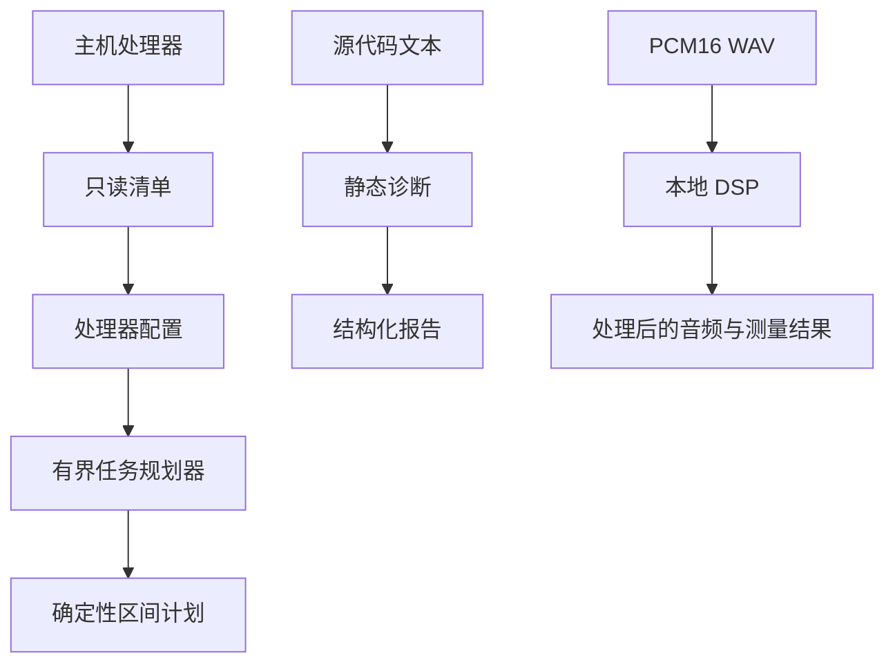
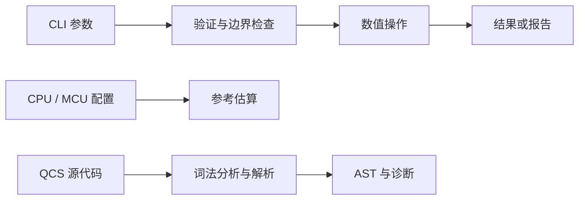

# Pytyliki — 处理器系统工作站

[English](README.md) · [Українська](README.uk.md) · [Русский](README.ru.md) · [简体中文](README.zh-CN.md)

[CI](https://github.com/Ivan-VHS/Pytyliki/actions/workflows/ci.yml) · [Windows 桌面构建](https://github.com/Ivan-VHS/Pytyliki/actions/workflows/desktop-build.yml) · C11 · Windows/Linux · MIT
**开发者：** [Ivan-VHS](https://github.com/Ivan-VHS)

Pytyliki 是一个模块化原生工作站，用于处理器信息发现、有界工作负载规划、源代码静态诊断、数值工具和本地 DSP。Windows 桌面程序与命令行工具共享同一个 C11 核心。

工作站报告读取到的处理器信息；建议性计划不会修改操作系统调度、CPU 亲和性、频率或电压设置。

## Windows 实际运行截图

<p align="center"></p>

## 功能数据流

该图概述项目输入来源、处理阶段和生成结果之间已经实现的数据流转。



## 执行路径与输出

第二张图将当前可执行路径和受支持输出与仅登记在目录中或尚不可用的行为区分开。



<sub>应用实际截屏 · 原始图像为 1920×1080 · 保留原始像素，不进行人为放大。</sub>

## 功能范围

| 模块 | 当前功能 | 安全边界 |
|---|---|---|
| CPU | 型号、拓扑、内存、ISA/XCR0 与处理器配置 | 只读检测 |
| 测试 | CPU、内存、矩阵及经过检查的工作负载分区 | 有界本地测量 |
| 源码 | 静态诊断和结构化报告 | 不构建或执行被检查的源码 |
| DSP | PCM16 WAV、滤波、压缩、饱和和电平测量 | 本地缓冲区；验证 RIFF 分块边界 |
| 内存 | 类型化 views、checked slices、arena 和 pool | 固定限制并检查范围 |
| Embedded C | MCU 配置、FLASH/SRAM 估算和 MMIO 模型 | 仅模拟与参考数据 |
| Rules / APSIA / TRACE | 负载建议、任务规划和测量溯源 | 证据记录，不是认证 |
| QCS | lexer、parser、AST 和诊断 | 仅语法分析 |
| Interop | 版本化 C ABI v1 | 显式选择可信库 |

## 构建与测试

需要 CMake 3.16+、C11 编译器和 Git。

```sh
cmake -S . -B build -DCMAKE_BUILD_TYPE=Release -DBUILD_TESTING=ON
cmake --build build --config Release --parallel
ctest --test-dir build -C Release --output-on-failure
```

Windows 工作流会构建 GUI 和 CLI 工具、运行 CTest，并发布 Windows x64 压缩包。当前归档包含 `pytyliki-gui.exe`、`pytyliki.exe`、`pytyliki-apsia.exe` 和 `pytyliki-metrics.exe`。

## CLI 示例

```sh
pytyliki --profile
pytyliki --suite
pytyliki --systems
pytyliki --embedded profiles
pytyliki-metrics --demo

pytyliki --divide -17 5
pytyliki --partition 10000 8 256
pytyliki --partition-auto 10000 256
```

分区计划是确定性的、有界的建议。它描述连续工作区间，但不会创建线程、修改 CPU affinity 或声称未经测量的性能提升。

## 目录规模

| 目录 | 条目 |
|---|---:|
| 系统语言能力 | 66 |
| CPU / MCU / 虚拟 ISA 配置 | 14 |
| 系统实验室功能 | 33 |

[功能](docs/FEATURES.md) · [UI motion](docs/UI_MOTION.md) · [架构](docs/ARCHITECTURE.md) · [除法与分区](docs/DIVISION_ENGINE.md) · [TRACE 溯源](docs/TRACE_MEASUREMENT_PROVENANCE.md) · [文档索引](docs/README.md)

[English](README.md) · [Русский](README.ru.md) · [Українська](README.uk.md) · [Releases](https://github.com/Ivan-VHS/Pytyliki/releases) · [MIT](LICENSE)
