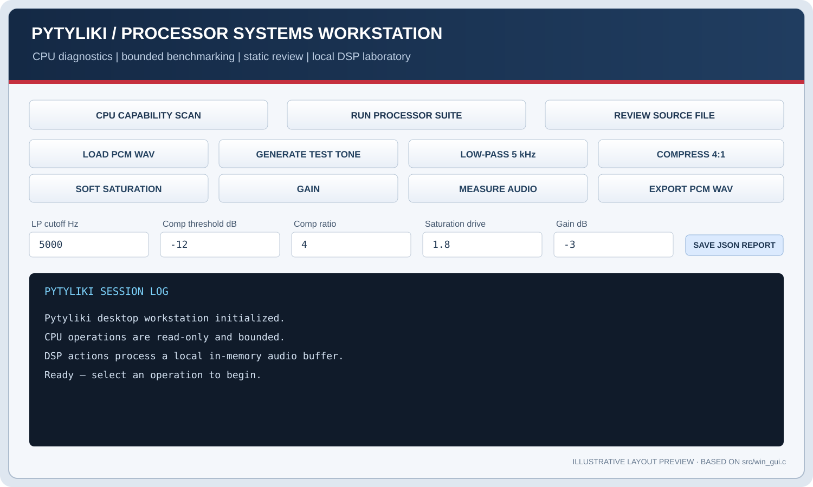

# Pytyliki — 处理器系统工作站

<p align="center">
  <a href="https://github.com/Ivan-VHS/Pytyliki/actions/workflows/ci.yml"></a>
  
  
  
</p>

<p align="center"><strong>发现 · 分析 · 处理 · 验证</strong></p>

<p align="center"></p>

**一套面向计算机与本地工作负载的实用 C11 工作站。** Pytyliki 将只读处理器信息发现、受限基准测试、源代码诊断、PCM16 WAV/DSP 工具以及原生 Windows 桌面界面整合为一个模块化项目。

它面向需要清晰本地测量、可检查报告和明确安全边界的开发者与工程师，而不是会悄悄修改硬件设置的黑盒工具。

**语言：** [English](README.md) · [Русский](README.ru.md) · [Українська](README.uk.md) · 简体中文

## 工作站功能一览

| 工作区 | 功能 |
|---|---|
| **处理器实验室** | 查看 CPU 信息、逻辑处理器、内存和可用 ISA 能力 |
| **基准测试套件** | 运行受限的处理器、内存和矩阵工作负载，用于本机比较 |
| **源代码审查** | 检查受支持的源文件，不执行或改写文件；导出 JSON 报告 |
| **音频 / DSP** | 读取和写入 PCM16 WAV、生成测试音、处理音频并测量电平 |
| **Windows 桌面端** | 使用原生 Win32 GUI 执行处理器扫描、源代码审查和音频操作 |
| **工程目录** | 浏览改进分类、建议性硬件规则和参考方案 |
| **验证** | 在 Windows 和 Linux 上使用 CMake 构建并运行 CTest |

## 查看界面

<p align="center"></p>

<sub>此界面预览根据仓库中的 Win32 控件与标签重绘，并非从实际运行的 Windows 程序截取的屏幕截图。</sub>

桌面应用包含 CPU 能力扫描、处理器测试、源代码审查、PCM WAV 导入/导出、测试音生成、低通滤波、压缩、饱和、增益、电平测量和 JSON 报告导出。

## 系统架构

<p align="center"></p>

## 快速开始

### 环境要求

- Windows 或 Linux
- CMake 3.16 或更新版本
- 支持 C11 的编译器
- Git

### 构建与测试

```bash
git clone https://github.com/Ivan-VHS/Pytyliki.git
cd Pytyliki
cmake -S . -B build -DCMAKE_BUILD_TYPE=Release -DBUILD_TESTING=ON
cmake --build build --config Release --parallel
ctest --test-dir build -C Release --output-on-failure
```

Windows 构建还会生成 **`pytyliki-gui.exe`**。

### 常用命令

```bash
# 只读处理器信息
./build/pytyliki --profile

# 受限 CPU、内存和矩阵测试
./build/pytyliki --suite

# 查看工程改进目录
./build/pytyliki --improvement-plan

# 生成 48 kHz PCM16 WAV 测试音
./build/pytyliki --tone-out test-tone.wav --frequency 440 --seconds 3

# 导出本地 JSON 报告
./build/pytyliki --json report.json
```

在 Windows 上，请使用对应构建配置下的可执行文件路径，例如 `build/Release/pytyliki.exe`。

## 工程能力

- **处理器清单：** CPU 厂商/型号、架构、逻辑处理器数量、内存和 ISA 标志。AVX 系列可用性检查包含由操作系统管理的向量状态验证。
- **受限测量：** 处理器、内存和矩阵路径的本地工作负载。结果依赖硬件与平台，不构成认证。
- **静态源代码诊断：** 检查受支持的源文件，不执行或更改文件内容。
- **PCM16 音频工具：** WAV 导入/导出、测试音生成、低通滤波、压缩器、软饱和、增益和电平计量。
- **Syntax-pie：** 确定性的 20 层函数与语法抽象目录；它是查询目录，不是通用解析器。
- **改进矩阵：** 20 项工程分类、20 项优化分类和 20 项自动化分类，可通过 `--improvement-plan` 查看。
- **HyperFusion：** 六个受限分析模块，每轮包含 36 个有向配对交互。就绪度和协同值属于规划启发式指标，并非实测性能提升。
- **APSIA 2.0：** 带目标可用性和 FFI 成本门控的语言路由规划器。它提出路由方案，但不会编译或执行所选语言模块。
- **硬件规则：** 已实现 12 条建议性规则；其他目录标识符为预留项。分析结果用于工程审查，不构成硬件认证。
- **参考流水线：** C11/C23 规划模型，并非生产级转译器。

## CI、质量与安全

GitHub Actions 在 **Ubuntu 和 Windows** 上构建并测试项目。独立的 Linux 任务会使用 AddressSanitizer 和 UndefinedBehaviorSanitizer 运行测试。每个提交的当前状态以 CMake/CTest 结果为准。

Pytyliki 遵循明确的本地操作边界：

- 处理器信息发现为只读操作；不会写入固件、BIOS/UEFI、微码、时钟、 电压、功率限制、内核、驱动或设备寄存器。
- 源代码审查不会执行或改写被扫描文件。
- 基准测试受到工作量限制，并取决于硬件、操作系统、编译器和工作负载；不保证性能提升。
- 建议性评分和规划目录不等于硬件认证，也不能证明自动优化已经实现。
- 本地音频处理使用受限的 PCM16 WAV 缓冲区。

## 兼容性

| 项目 | 当前范围 |
|---|---|
| 实现语言 | ISO C11 |
| CI 验证平台 | Windows 和 Linux |
| 桌面界面 | Windows 原生 Win32 GUI |
| 数据格式 | JSON 报告；PCM16 WAV |
| 构建与测试 | CMake + CTest |
| 未作出的声明 | macOS 支持、保证的 ARM64/x86_64 性能、生产级 RTL/FPGA 综合或自主源代码转换 |

## Embedded C 与微控制器配置

原生 C11 核心现已包含 Cortex-M4、RV32IMC 和 ATmega328P 配置目录、
带溢出检查的 FLASH/SRAM 预算计算、带可写位掩码的 MMIO 寄存器模拟器，
以及最小 C 源文件模板生成器。

~~~sh
./build/pytyliki --embedded profiles
./build/pytyliki --embedded profile cortex-m4-reference
./build/pytyliki --embedded budget cortex-m4-reference 8192 1024 128 512 2048
./build/pytyliki --embedded template ./main.c
~~~

Win32 界面新增 **EMBEDDED C** 按钮。Cortex-M4 和 RV32IMC 配置属于参考配置，
并非特定开发板定义。模拟器不会访问物理 MMIO 地址；模板也不会替代厂商启动代码、
中断向量表、时钟配置或引脚复用检查。Reaper 提供交叉编译编排和 ELF/MAP 分析。
参见 [Embedded C 指南](docs/EMBEDDED_C.md)。

## 文档

- [系统架构](docs/ARCHITECTURE.md)
- [APSIA 2.0 路由设计](docs/APSIA_2.0.md)
- [硬件规则引擎](docs/HARDWARE_RULE_ENGINE.md)
- [处理器分类](docs/PROCESSOR_TAXONOMY.md)
- [平台验证策略](docs/PLATFORM_VALIDATION_POLICY.md)
- [递归演进模型](docs/RECURSIVE_EVOLUTION.md)
- [质量审计](docs/QUALITY_AUDIT_0.7.1.md)


## 原生桌面应用

项目已包含原生 **Win32 工作站 GUI**。Windows x64 软件包包含：
- `pytyliki-gui.exe` — 处理器清单、源码检查和 PCM16/DSP 工具的桌面界面。
- `pytyliki.exe` — 命令行工作站。
- `pytyliki-apsia.exe` — APSIA 路由工具。

- [Windows x64 Releases](https://github.com/Ivan-VHS/Pytyliki/releases)
- [桌面构建工作流与 CI 工件](https://github.com/Ivan-VHS/Pytyliki/actions/workflows/desktop-build.yml)
- [最新构建运行](https://github.com/Ivan-VHS/Pytyliki/actions/workflows/desktop-build.yml?query=branch%3Amain)

成功运行会上传 `Pytyliki-windows-x64.zip`；`v*` 标签会发布 GitHub Release。GUI 仅支持 Windows；Linux CI 继续验证可移植的 C11 核心和 CLI。


## 版本化内存与原生 C 接口

内存内核提供 **memory ABI v2**（PL_MEMORY_ABI_VERSION = 2）：类型化零拷贝视图、有界 arena、基于实际地址的对齐、mark/rewind 检查点、可选的回退区域清零、高水位与分配次数统计、自定义分配器回调，以及由调用方持有存储的固定块池。由于 arena 描述符加入了遥测字段，跨二进制边界嵌入 pl_arena_t 的调用方必须使用匹配的头文件和 ABI 重新构建。

可选的原生指标接口提供 **Pytyliki C ABI v1**（PYTYLIKI_ABI_VERSION = 1），包含版本查询以及针对连续 float64 缓冲区的点积、范数、距离和正交性函数。调用是同步的，使用调用方拥有的缓冲区，返回后不会保留这些指针。ABI v1 是范围有限的互操作接口，并不表示所有 Pytyliki 模块都可从其他语言调用。

可通过 CLI 使用架构图谱：

~~~bash
./build/pytyliki --systems
./build/pytyliki --architectures
./build/pytyliki --architecture x86_64
~~~

参见 [Memory Kernel ABI v2](docs/MEMORY_ARENA.md)、[Architecture 66 契约](docs/ARCHITECTURE_66.md) 和公开的 [C ABI 头文件](src/interop.h)。

## 许可证

本项目采用 [MIT 许可证](LICENSE)。

## 内存内核的额外优化

固定块池现在按字节扫描位图：跳过已完全占用的字节，并在第一个未满字节中选择第一个空闲块，保持确定性的 first-fit 分配顺序。这样可以避免逐个检查已满的块，同时不改变分配次序。测试覆盖 16 个块的填满、耗尽时拒绝分配、释放后重新使用，以及占用计数的正确性。
